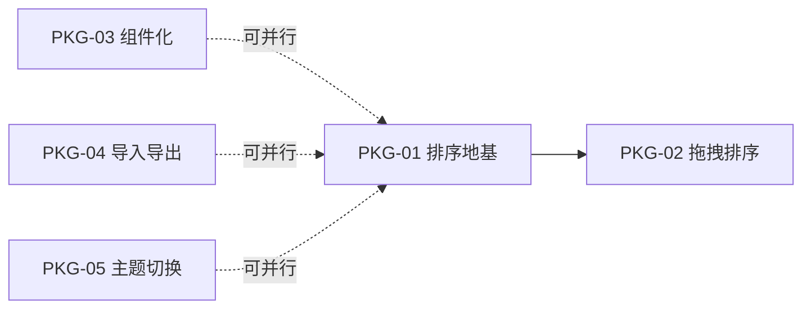

# 标准工作流程

## 1. 任务准备（ROOT）

1. 确认仓库基线：当前分支、工作树状态、已知未提交改动清单。
2. 从 `docs/process/task-allocation.md` 读取任务包定义（PKG-XX、依赖、验收标准）。
3. 生成任务说明：目标、文件白名单/黑名单、验收标准、报告要求，消息独立完整。

## 2. 批次派发（ROOT）

1. 按依赖关系分批：无依赖或依赖已完成的包先发；有依赖的包等前置包验收通过。
2. 同一批只放行文件交集为空的组合（示例：PKG-01 + PKG-05）。
3. 每个执行 agent 一个任务包；root 等待各 agent 完成并收集报告。

## 3. 执行（EXEC）

1. 读取任务说明，并阅读 `docs/process/task-allocation.md` 对应小节。
2. 只修改白名单文件；保留其他未提交产物。
3. 按验收标准完成验证（测试 / 静态检查 / 手动冒烟），记录证据。
4. 产出最终报告：改动摘要、验收逐条核验结果、遗留问题。

## 4. 验收（ROOT）

1. 逐条核对验收标准，运行可执行验证（如 `node .../__tests__/sorting.test.js`）。
2. 用 `git diff` 审查是否越界改动、是否回退他人产物。
3. 通过：提交（消息格式见下）或放行下一批；不通过：反馈执行 agent 修复后复审。
4. 可选：创建 REVIEW agent 做独立审查。

## 5. 完成（ROOT）

1. 所有任务包验收通过后，汇总结果报告用户。
2. 更新 `docs/process/task-allocation.md` 中的执行状态（如适用）。

## 提交消息格式

```text
特性: <任务包说明>
```

示例：`特性: PKG-01 统一排序数据结构（reorder 纯函数 + 存量补值）`

## V3 MVP 当前依赖图（参考）



注意：PKG-03/04/05 与 PKG-02 存在文件交集时须串行执行；具体批次由 root 按当前
工作区状态决定。
