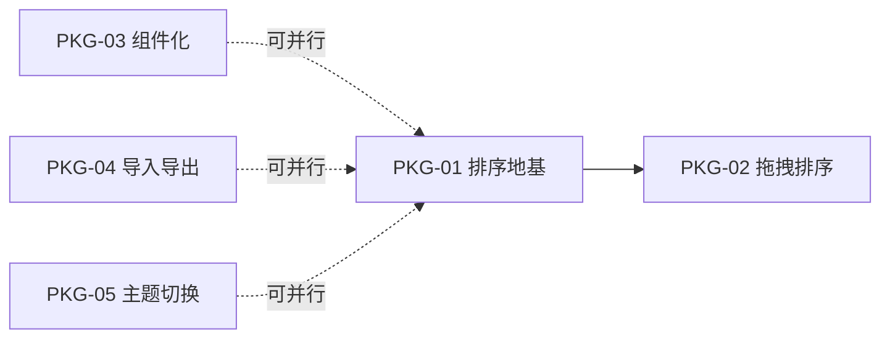

# 凌睿科技导航页 V3 MVP 任务分配计划

> 文档状态：v1.1 · 生成：2026-08-13 · 依据：`../product/05-PRD.md`（F-01~F-04）、`../product/06-MVP.md`、`../product/07-产品待办.md`（PBI-01~18）、`../product/09-甘特图.md`
> 说明：本计划仅覆盖 Phase 1 MVP（PBI-01~07、PBI-09）。执行 agent 由上级 root 直接创建（每个 agent 独立负责一个任务包，禁止 agent 间互相 spawn）。
> **历史记录（2026-08-14 定稿，2026-10-25 补路径）**：PKG-01~05 全部功能已在源码实现并提交（git 6b78f2a），PKG-01 已产出验收测试 `tests/unit/sorting.test.js`；下方任务包详情的"验收标准"可作为对已实现代码的验收清单使用，本计划的批次/并行策略保留作历史参照。**本文不再作为新任务来源**，新任务由 root 在任务说明里直接定义（见 `../../.agents/workflow.md`）。**注**：文中出现的 `05-PRD.md` 等裸文件名均为 2026-09-22 目录重组前的 `docs/product/` 内同级引用，重组后本文已移到 `docs/process/`，阅读时请按上行的完整相对路径理解。

---

## 一、分配总览

| 任务包 | 名称 | 包含 PBI | 对应功能/故事 | 依赖 | 工作量 | 建议执行 |
|--------|------|----------|---------------|------|--------|----------|
| PKG-01 | 统一排序数据结构 | PBI-01 | F-01 / US-03 | 无 | M | 第 1 批（地基） |
| PKG-02 | 书签与分类拖拽排序 | PBI-02、PBI-03 | F-01 / US-01、US-02 | PKG-01 | M | 第 2 批 |
| PKG-03 | 组件注册机制与显示开关 | PBI-04、PBI-05 | F-02 / US-04、US-05 | 无 | M | 第 1 批可并行 |
| PKG-04 | 数据导出与导入 | PBI-06、PBI-07 | F-03 / US-07、US-08 | 无 | M | 第 1 批可并行 |
| PKG-05 | 深浅主题切换 | PBI-09 | F-04 / US-10 | 无 | M | 第 1 批可并行 |

> Phase 2/3 的 PBI-08、PBI-10~18 不在此计划内；review-report.md 的 P2-1（一键清空预设/安装教程）与 P2-5（PBI-17 决策检查点）作为执行期决策项记录在"待决事项"。

---

## 二、任务包详情

### PKG-01 统一排序数据结构

**目标**：让书签、分类、分类内链接统一使用 sortOrder 语义，并提供可测试的 reorder 纯函数。

**涉及文件**：
- 修改：`src/scripts/storage.js`
- 新增：`tests/unit/sorting.test.js`（可选，Phase 1 允许手动验证）

**实施要点**：
- 在 storage.js 增加 `reorder(items, fromIndex, toIndex)` 纯函数（返回新数组，不修改入参）。
- 统一读取逻辑：所有列表按 `sortOrder` 升序、同序按原数组顺序稳定排序。
- 存量数据无 sortOrder 时按当前顺序补值（不丢数据）。
- 提供 `Storage.reorderBookmarks(from, to)`、`Storage.reorderCategories(from, to)` 封装，内部批量写回 sortOrder。

**验收标准**：
1. `reorder([a,b,c,d], 0, 2)` 返回 `[b,c,a,d]`；移动到首/尾边界正确。
2. 书签与分类排序后刷新页面顺序保持。
3. 无 sortOrder 的存量数据读取后自动获得顺序且不丢数据。
4. 原数组不被 reorder 修改（纯函数）。

**依赖**：无

---

### PKG-02 书签与分类拖拽排序

**目标**：主页书签与分类卡片支持鼠标拖拽换位，提供键盘上移/下移替代。

**涉及文件**：
- 修改：`src/scripts/main.js`（渲染 + 拖拽事件）
- 修改：`src/scripts/settings.js`（键盘替代按钮）
- 修改：`src/styles/main.css`（拖拽中视觉反馈样式）

**实施要点**：
- 使用 HTML5 Drag and Drop：拖拽源设置 `draggable`，放置位设置占位/高亮。
- 拖拽结束调用 `Storage.reorderBookmarks/Categories` 并重新渲染。
- 键盘用户：设置面板或卡片提供"上移/下移"按钮，调用同一 reorder API。
- 拖拽中半透明 + 占位符视觉反馈；边界不越界、不丢项。

**验收标准**：
1. 按住书签可拖动，拖拽过程有半透明/占位反馈。
2. 松开后顺序立即保存，刷新后保持。
3. 分类卡片可拖拽换位，子链接随分类移动不丢失；空分类可排序。
4. 键盘上移/下移可达同样效果。
5. 50+ 书签时拖拽无卡顿。

**依赖**：PKG-01

---

### PKG-03 组件注册机制与显示开关

**目标**：主页区块（搜索/书签/分类/待办/天气/农历/壁纸按钮）改为注册表驱动，设置页可开关组件。

**涉及文件**：
- 修改：`src/scripts/main.js`（注册表 + 按配置渲染）
- 修改：`src/index.html`（区块加 data-component 标记）
- 修改：`src/scripts/settings.js`（组件管理 UI）
- 修改：`src/scripts/storage.js`（组件可见性持久化，默认全开）
- 修改：`src/styles/settings.css`（组件列表样式）

**实施要点**：
- 定义 `COMPONENTS` 注册表：`{ id, title, render, defaultVisible }`，覆盖搜索、快捷书签、分类、待办、天气、农历日历、壁纸设置入口。
- 主页渲染统一按注册表 + 存储中的可见性配置输出。
- 设置面板"组件"区块：每项一个开关（checkbox），保存后主页即时刷新。
- 搜索框为常驻组件，不允许关闭。

**验收标准**：
1. 关闭某组件后主页对应区块隐藏，刷新后保持。
2. 重新开启后区块恢复。
3. 搜索框始终可见（关闭开关不生效）。
4. 现有 7 个区块全部走注册表渲染，视觉无回归。

**依赖**：无

---

### PKG-04 数据导出与导入

**目标**：设置面板支持一键导出 JSON 备份、导入恢复（校验 + 失败回滚）。

**涉及文件**：
- 修改：`src/scripts/settings.js`（数据区块 UI）
- 修改：`src/scripts/storage.js`（导出/导入/校验函数）
- 修改：`src/styles/settings.css`（按钮与提示样式）

**实施要点**：
- 导出：收集 bookmarks/categories/settings/todos + schemaVersion，生成文件名 `lingrui-nav-backup-YYYY-MM-DD.json` 下载。
- 导入：文件选择 → JSON 解析 → 结构校验（字段类型/必填）→ 导入前备份当前数据 → 写入 → 刷新主页；失败提示具体错误并保持原数据。
- 校验函数 `validateBackup(data)` 返回错误列表（可测试纯函数）。
- 导入成功提示还原统计（书签/分类/待办数量）。

**验收标准**：
1. 导出文件含全部数据项与 schemaVersion。
2. 合法备份导入后书签/分类/设置/待办完整还原。
3. 非 JSON/结构缺失/类型错误文件给出明确错误，现有数据不变。
4. 导入成功后主页立即刷新。
5. 导出过程无任何网络请求。

**依赖**：无

---

### PKG-05 深浅主题切换

**目标**：设置面板提供浅色/深色主题选项，CSS 变量驱动，即时生效并持久化。

**涉及文件**：
- 修改：`src/styles/main.css`（浅色变量集 + data-theme 覆盖）
- 修改：`src/styles/settings.css`（设置面板主题适配）
- 修改：`src/scripts/main.js`（applySettings 应用主题）
- 修改：`src/scripts/settings.js`（主题选项 UI）

**实施要点**：
- 在 `:root` 定义浅色/深色两套语义变量（背景、文字、玻璃卡片、边框、滚动条）。
- `document.documentElement.dataset.theme = 'dark' | 'light'`，CSS `[data-theme="dark"]` 覆盖变量。
- 设置面板新增"主题"选项（浅色/深色），保存到 settings.theme，应用时即时生效。
- 现有 `--accent-*` 壁纸取色体系保持不变，两套主题都引用。

**验收标准**：
1. 切换即时生效，无需刷新。
2. 深色/浅色下搜索、书签、分类、待办、天气、农历浮层、设置面板均可读。
3. 选择持久化，重开扩展保持。
4. 无变量遗漏导致的文字不可见。

**依赖**：无

---

## 三、执行顺序与并行策略

- **第一批（可 2 agent 并行）**：PKG-01 + PKG-05（两包文件交集为空，唯一合法并行组合）。
- **注意**：PKG-03（含 storage.js 组件可见性持久化）与 PKG-04（含 storage.js 导出/导入函数）均与 PKG-01 共享 storage.js，文件交集非空，**必须与 PKG-01 串行**，不得与 PKG-01 并行。
- **第二批**：PKG-02（依赖 PKG-01 完成后启动）；且 PKG-02 与 PKG-03/04/05 文件交集非空（main.js/settings.js/main.css/settings.css），需等 PKG-03/04/05 完成后串行执行。
- 原则：同一批最多 2 个执行 agent（并发槽位含 root 共 4），避免并行修改同一文件。
- 每个任务包完成后由 root 运行验收清单（对应各 PKG 验收标准）后再放行下一批。

## 四、风险说明

| 风险 | 影响 | 缓解 |
|------|------|------|
| PKG-03 重构面大可能引入回归 | 高 | 迁移按"注册表渲染 → 开关控制"两步走，每步跑现有冒烟 |
| PKG-04 导入损坏数据 | 高 | 校验先行 + 导入前自动备份 + 失败回滚 |
| 并行修改同一文件 | 高 | 任务包文件交集为空的组合才并行；PKG-02 与 PKG-01 串行 |
| 主题变量遗漏 | 中 | 逐组件视觉检查清单 |

## 五、待决事项（执行期决策）

1. **P2-1**：是否补入"一键清空预设数据"与"安装图文教程"（建议 Phase 2 排期时决定）。
2. **P2-5**：PBI-17（Firefox/Edge 兼容）在第 7 周初设置评估检查点。
3. 组件顺序调整（US-06）本期只做开关，顺序调整 UI 放 Phase 2。
