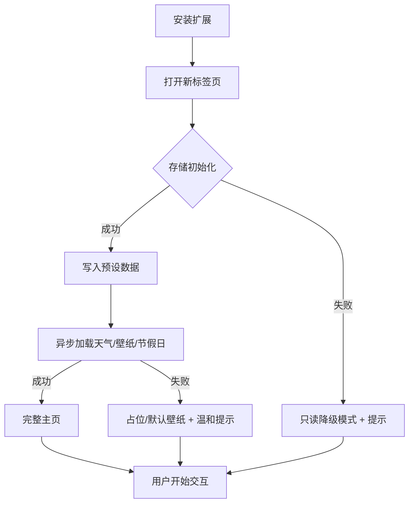
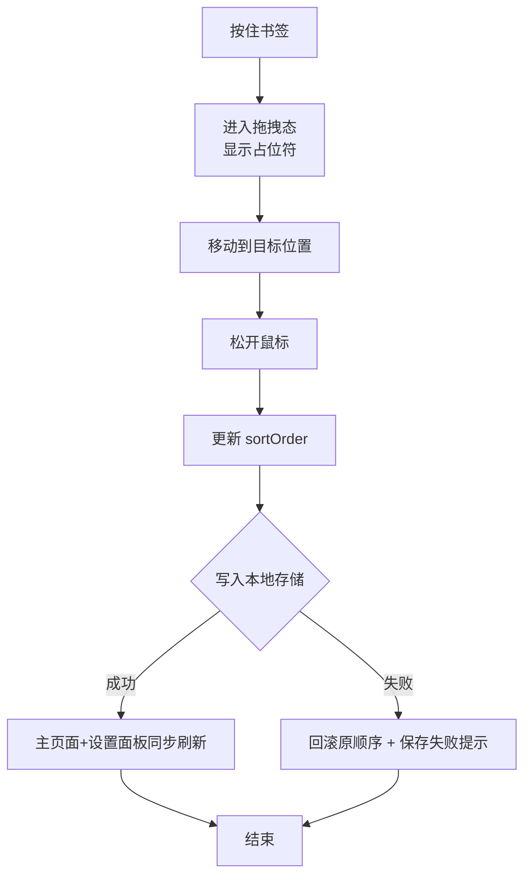
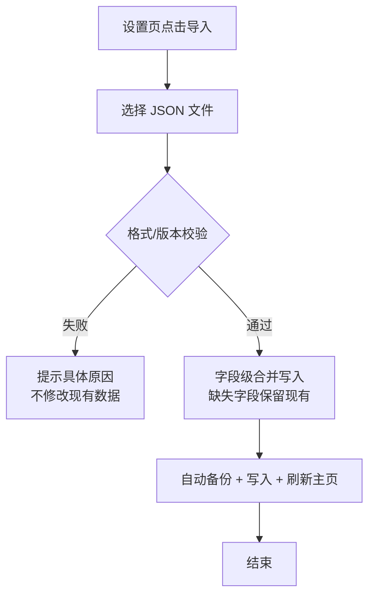
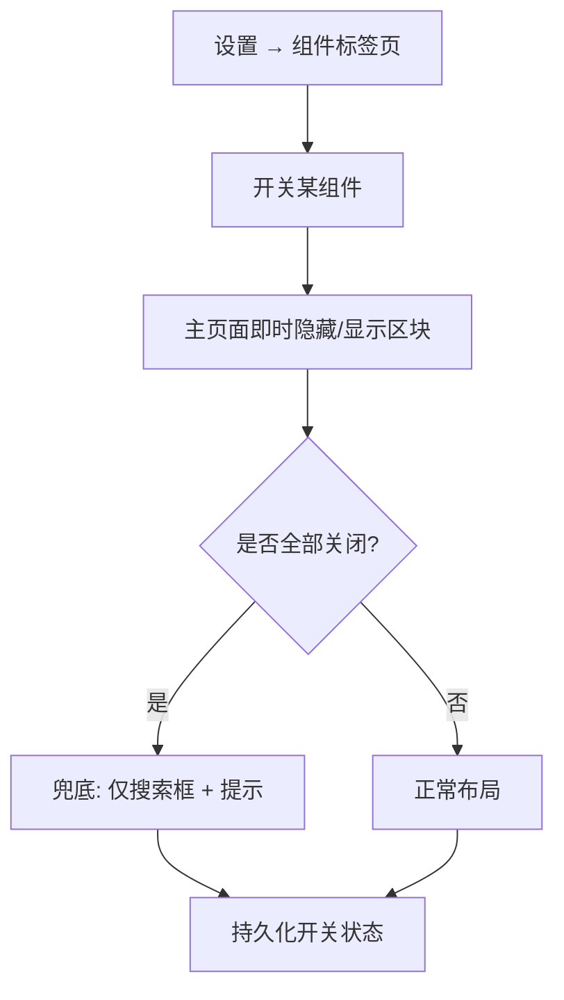

# 用户用例与用户流程（Use Cases & Flows）

> 文档状态：v1 初稿 · 归属：凌睿科技导航页 · 关联：01-用户画像.md、02-用户故事.md、05-PRD.md
> 说明：用例覆盖"现有功能 + 规划中功能"，规划中功能以 ★ 标注；主流程步骤为"参与者可见"的可验证行为。

---

## 用例总览

| ID | 用例 | 参与者 | 优先级 | 状态 |
|----|------|--------|--------|------|
| UC-01 | 首次安装并启用扩展 | 新用户 | P0 | 现有 |
| UC-02 | 日常搜索与引擎切换 | 所有用户 | P0 | 现有 |
| UC-03 | 书签整理与拖拽排序 ★ | 效率用户 | P0 | 规划 |
| UC-04 | 分类管理 | 效率用户 | P0 | 现有(部分)/规划(拖拽) |
| UC-05 | 导出配置备份 ★ | 隐私用户 | P0 | 规划 |
| UC-06 | 导入配置恢复 ★ | 隐私用户 | P0 | 规划 |
| UC-07 | 主题切换 ★ | 审美用户 | P0 | 规划 |
| UC-08 | 组件开关配置 ★ | 审美/极简用户 | P0 | 规划 |
| UC-09 | 查看农历与节假日 | 农历用户 | P0 | 现有(部分)/规划(增强) |
| UC-10 | 待办事项管理 | 效率用户 | P0 | 现有 |
| UC-11 | 壁纸切换与天气查看 | 所有用户 | P0 | 现有 |

---

## UC-01 首次安装并启用扩展

**参与者**：新用户（P1/P2/P3）
**前置条件**：用户已安装 Chrome，可从本地加载或已获取扩展包

**主流程**：
1. 用户安装扩展并在新标签页打开主页。
2. 系统展示默认壁纸与预设内容（书签、分类、时钟、天气、待办、农历）。
3. 系统初始化本地存储（chrome.storage.local 或 localStorage 降级），写入预设数据。
4. 系统异步加载天气、壁纸与节假日数据（失败自动降级，不阻塞页面）。
5. 用户看到完整可用的主页。

**扩展流程**：
- 3a. 存储初始化失败：页面降级为"只读演示"模式并提示，不白屏。
- 4a. 天气/壁纸数据加载失败：显示占位或默认壁纸，5 秒内不报错。

**后置条件**：本地存储包含预设数据；主页可交互。
**验收要点**：首次打开 3 秒内页面可用；无控制台报错。

---

## UC-02 日常搜索与引擎切换

**参与者**：所有用户
**前置条件**：主页已加载

**主流程**：
1. 用户点击搜索框或直接输入。
2. 用户输入关键词，回车（或点击搜索按钮）。
3. 系统使用当前引擎（Google/百度/Bing）在新标签页打开搜索结果。
4. 用户点击引擎按钮可在三引擎间循环切换，当前引擎高亮显示。

**扩展流程**：
- 2a. 输入为 URL 时直接打开该网址（需确认现有行为，若未实现则不承诺）。
- 3a. 快捷键 `/` 或 `Ctrl/Cmd+K` 聚焦搜索框（★ 规划）。

**后置条件**：搜索在新标签页完成，主页状态不变。

---

## UC-03 书签整理与拖拽排序 ★

**参与者**：效率用户（P1）
**前置条件**：已登录主页；存在 ≥2 个书签

**主流程**：
1. 用户鼠标按住某个书签图标。
2. 书签进入"可拖拽"状态，显示半透明跟随与目标占位符。
3. 用户移动到目标位置后松开。
4. 系统立即更新顺序并持久化到本地存储。
5. 设置面板与主页面书签顺序同步更新。

**扩展流程**：
- 3a. 拖到列表首/尾：书签落到最前/最后，不越界。
- 3b. 键盘用户：在设置面板用"上移/下移"按钮替代（★）。
- 5a. 存储写入失败：页面回滚到原顺序并提示"保存失败"。

**后置条件**：新顺序持久化；无书签丢失。

---

## UC-04 分类管理

**参与者**：效率用户（P1）
**前置条件**：主页已加载

**主流程**：
1. 用户打开设置 → 分类标签页。
2. 用户可新增分类（输入名称）、重命名、删除。
3. 用户可在主页面拖拽调整分类显示顺序（★）。
4. 系统保存变更并重新渲染。

**扩展流程**：
- 2a. 删除非空分类：确认弹窗提示"分类内书签将一并删除或移入未分类"（需产品决策，默认建议：一并删除，弹窗说明）。
- 3a. 与书签共用拖拽组件，行为一致。

**后置条件**：分类与书签归属一致；数据持久化。

---

## UC-05 导出配置备份 ★

**参与者**：隐私用户（P1）/ 折腾型用户（P4）
**前置条件**：存在用户数据（书签/分类/待办/设置）

**主流程**：
1. 用户打开设置 → 数据（或通用）标签页，点击"导出"。
2. 系统收集全部用户数据，序列化为 JSON（含 schema 版本号与导出时间）。
3. 浏览器下载 `lingrui-nav-backup-YYYYMMDD.json` 文件。

**扩展流程**：
- 2a. 导出内容较大：仍为单文件，文件内嵌数据结构说明。
- 3a. 下载被浏览器拦截：提示用户允许下载或复制到剪贴板。

**后置条件**：用户获得可读、可迁移的 JSON 备份。

---

## UC-06 导入配置恢复 ★

**参与者**：隐私用户（P1）/ 折腾型用户（P4）
**前置条件**：用户持有有效备份 JSON

**主流程**：
1. 用户打开设置 → 数据标签页，点击"导入"。
2. 用户选择 JSON 文件。
3. 系统校验格式、版本与字段完整性。
4. 校验通过后按"字段级合并"写入：备份含有的字段覆盖现有数据，缺失字段保留现有数据；导入前自动备份当前数据。
5. 系统写入完成后刷新主页。

**扩展流程**：
- 3a. 校验失败（损坏/版本过高）：提示具体原因，不修改现有数据。
- 4a. 写入失败：自动回滚到导入前备份，提示重试。

**后置条件**：主页展示导入后的数据；导入前已自动备份（最近 3 份轮转），导入失败自动回滚。

---

## UC-07 主题切换 ★

**参与者**：审美用户（P3）
**前置条件**：主页已加载

**主流程**：
1. 用户打开设置 → 外观标签页，选择"浅色/深色"两档。
2. 系统应用主题并持久化。

**扩展流程**：
- 1a. 手动选择主题后，壁纸取色自动适配对比度（★ 规划 US-11）。
- 2a. 深色主题下所有子界面（日历浮层/天气弹层/设置面板）同步生效。
- 3a. （后续迭代，非 MVP）跟随系统/跟随壁纸档位见 PBI-10。

**后置条件**：主题状态持久化；全页面无颜色遗漏。

---

## UC-08 组件开关配置 ★

**参与者**：极简用户（P3）
**前置条件**：主页已加载

**主流程**：
1. 用户打开设置 → 组件标签页。
2. 用户对时钟/天气/待办/农历日历/书签/分类分别开/关。
3. 系统即时更新主页面，隐藏关闭组件、显示开启组件。
4. 系统持久化开关状态。

**扩展流程**：
- 2a. 全部关闭：页面仅保留搜索框 + 顶部工具，显示兜底文案。
- 3a. 关闭天气组件时同时停止其网络请求（隐私友好）。

**后置条件**：页面布局与开关状态一致；刷新后保持。

---

## UC-09 查看农历与节假日

**参与者**：农历用户（P2）
**前置条件**：主页已加载；农历组件开启

**主流程**：
1. 用户点击顶部时间。
2. 系统弹出农历日历浮层，展示当月日历、农历日期、节气、节假日与调休标识。
3. 用户切换月份/年份查看。
4. 系统展示下一个节假日倒计时（★ US-12）。

**扩展流程**：
- 2a. 节假日数据拉取失败：回退内置 2026 兜底表，浮层标注"数据可能不完整"。
- 4a. 无即将到来的节假日：展示最近节日的日期，不出现负数倒计时。

**后置条件**：浮层可关闭，主页布局不变。

---

## UC-10 待办事项管理

**参与者**：效率用户（P1）
**前置条件**：主页已加载；待办组件开启

**主流程**：
1. 用户点击"+ 添加"输入待办内容，回车保存。
2. 用户点击待办项切换完成状态（划线/勾选）。
3. 用户可删除待办项。

**扩展流程**：
- 2a. 完成状态变更实时持久化。
- 3a. 删除后不可恢复，无需二次确认（轻量操作）。

**后置条件**：待办数据持久化；页面无刷新即更新。

---

## UC-11 壁纸切换与天气查看

**参与者**：所有用户
**前置条件**：主页已加载

**主流程**：
1. 用户点击壁纸按钮切换壁纸（3 套预设 → Bing 每日 → 随机，循环）。
2. 系统应用壁纸并自动取色，调整文字对比度。
3. 用户悬停天气区域查看 24 小时逐时预报。

**扩展流程**：
- 1a. Bing 每日壁纸拉取失败：跳过并提示，回退上一张可用壁纸。
- 3a. 天气未配置城市：按 IP 自动定位（现有逻辑），失败提示手动选择。

**后置条件**：壁纸与天气状态持久化（壁纸名、城市、缓存）。

---

## 关键用户流程（Mermaid）

### 流程 1：首次使用

### 流程 2：书签拖拽排序 ★

### 流程 3：数据导入恢复 ★

### 流程 4：组件配置 ★

---

## 用例 → 故事映射

| 用例 | 关联用户故事 |
|------|--------------|
| UC-01 | US-20（网页预览兼容） |
| UC-02 | US-22（搜索快捷键） |
| UC-03 | US-01、US-03 |
| UC-04 | US-02、US-03 |
| UC-05 | US-07 |
| UC-06 | US-08、US-09 |
| UC-07 | US-10、US-11 |
| UC-08 | US-04、US-05、US-06 |
| UC-09 | US-12、US-13、US-14 |
| UC-11 | US-21 |

