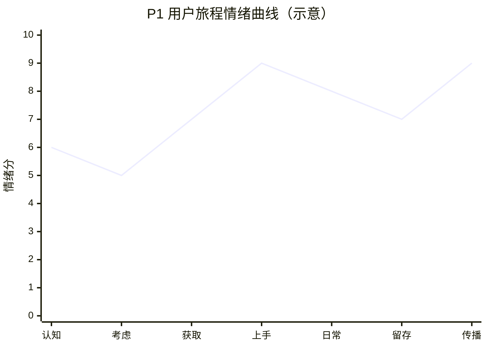

# 用户旅程地图（Customer Journey Map）

> 文档状态：v1 初稿 · 归属：凌睿科技导航页 · 关联：01-用户画像.md（以 P1 隐私逃离者为主线，P2/P3 为辅助视角）
> 说明：本项目是本地扩展，无账号体系，因此"Acquisition"理解为下载/安装，"Advocacy"理解为社区传播（V2EX/GitHub/朋友圈）。

---

## 主线 persona：P1 隐私逃离者

**JTBD**：每天 30-100 次回到新标签页时，用最少点击完成搜索与网站跳转，同时不交出任何个人数据。

---

## 七阶段旅程总表

| 阶段 | 触点 | 用户行为 | 想法与疑问 | 情绪 | 痛点 | 机会点 |
|------|------|----------|------------|------|------|--------|
| 1. 认知 Awareness | V2EX/GitHub/知乎帖子、商店截图、朋友推荐 | 刷到"开源无广告新标签页"讨论；点开详情看截图与权限 | "又是广告满天飞的产品？" "这个真的干净吗？" | 好奇 + 怀疑 | 竞品口碑差（Infinity 隐私争议）；信息真假难辨 | 公开仓库 + 权限透明截图；社区口碑传播（V2EX 帖子、GitHub README） |
| 2. 考虑 Consideration | GitHub README、扩展描述、权限列表、对比帖 | 对比 Tabliss/Bonjourr/Infinity；查看权限与数据流说明 | "农历 + 无埋点，别人没有" "权限只有 storage？" | 谨慎 + 期待 | 说明不清；没有上架商店导致信任门槛高 | 提供"隐私说明页"：权限清单 + 数据流图 + 无埋点声明 |
| 3. 获取 Acquisition | GitHub Releases / zip 包 / 开发者模式加载 | 下载 zip、解压、加载扩展 | "怎么装这么麻烦？" | 兴奋 + 轻微挫败 | 无商店自动安装，需要手动加载 | 提供图文安装教程（3 步）；README 首屏就是安装指引 |
| 4. 上手 Onboarding | 新标签页首页、预设数据、设置面板 | 首次打开看到默认壁纸与预设内容；尝试搜索、点时间看农历 | "挺好看" "默认书签不是我常用的" "怎么改？" | 惊喜 + 探索 | 预设书签与用户无关需手动清理；设置入口需要找 | 首次使用引导（一次性提示"点这里改书签"）；一键清空预设数据 |
| 5. 日常 Engagement | 搜索框、书签、天气、待办、农历浮层 | 高频使用搜索与书签；低频使用待办与天气；节假日看日历 | "想把这个书签放前面" "今晚天气怎么样" | 流畅/习惯 | 无法拖拽排序；深色模式缺失夜间刺眼；组件不能按需开关 | ★ 拖拽排序 + 主题切换 + 组件开关（本次 MVP 核心） |
| 6. 留存 Retention | 主页习惯、数据积累（书签/待办） | 书签与待办越来越多；更换设备/重装浏览器 | "重装后配置会丢吗？" "这个扩展还在维护吗？" | 依赖 + 隐忧 | 无云同步（已排除）；无导出导入 = 换机即丢失；无更新提示 | ★ 一键导出/导入 JSON；README/更新日志持续公开；社区可见活跃度 |
| 7. 传播 Advocacy | GitHub star、V2EX 推荐、社交截图 | 分享截图；向朋友推荐；给作者提 issue/PR | "这么干净的扩展应该让更多人知道" | 自豪 + 分享欲 | 无上架导致推荐门槛高（朋友不会装） | 精美截图物料 + 一句安装口令；README 徽章（stars/权限说明） |

---

## 关键时刻

**Aha moment（价值验证点）**：首次打开主页看到"农历 + 调休 + 天气"同时呈现，且确认无任何广告与埋点——此时用户确认"这就是我要的"。

**Moment of truth（决策点）**：
1. 安装环节（手动加载 zip）——门槛最高，教程质量决定去留。
2. 首次配置（清理预设、整理书签）——操作顺滑度决定是否继续。
3. 换机/重装场景——能否导出恢复，决定长期信任。

**Churn triggers（流失点）**：
1. 安装失败或教程不清晰（获取阶段流失最大）。
2. 发现无法按习惯调整布局（拖拽/主题/组件缺失）。
3. 数据丢失（无备份手段）或项目停更迹象。
4. 深色模式缺失导致夜间不适（审美用户群体流失）。

---

## 旅程中的情绪曲线

> 说明：获取阶段因手动安装挫败感短暂回落；日常阶段因拖拽/主题缺失从 9 回落至 8；留存阶段因"无备份"隐忧降至 7。

---

## 按影响 × 成本排序的改进建议

| 优先级 | 改进项 | 影响的阶段 | 影响 | 成本 | 对应故事 |
|--------|--------|------------|------|------|----------|
| 1 | 一键导出/导入 JSON | 留存 | 高（信任根基） | 低 | US-07/08 |
| 2 | 书签/分类拖拽排序 | 日常 | 高（高频痛点） | 中 | US-01/02 |
| 3 | 组件开关 + 注册机制 | 日常/上手 | 高（个性化） | 中 | US-04/05 |
| 4 | 深色/浅色主题 | 日常/留存 | 高（夜间用户） | 中 | US-10 |
| 5 | 农历信息卡片 + 节假日倒计时 | 上手/日常 | 中高（差异化） | 低 | US-12/13 |
| 6 | 隐私说明页（权限清单 + 数据流） | 认知/考虑 | 高（转化关键） | 低 | US-15 |
| 7 | 首次使用引导 + 一键清空预设 | 上手 | 中 | 低 | 新增建议 |
| 8 | 安装图文教程（README 首屏） | 获取 | 中高（流失最大） | 低 | 文档项 |
| 9 | 核心逻辑自动化测试 | 留存（维护） | 中（长期） | 中 | US-17 |
| 10 | 组件顺序调整 | 日常 | 中 | 低 | US-06 |
| 11 | 主题与壁纸联动 | 日常 | 中（锦上添花） | 中 | US-11 |
| 12 | 跨浏览器适配 | 获取/传播 | 中（远期） | 高 | US-19 |

---

## 快速见效项（Quick Wins）

1. **隐私说明页**：纯文案 + 权限清单，1 天内可完成，直接服务考虑阶段转化。
2. **安装图文教程**：README 首屏 3 步教程，消除最大流失点。
3. **一键清空预设数据**：设置页一个按钮，解决上手阶段"清理麻烦"。
4. **农历信息卡片**：在现有数据源上做展示层，成本低、差异化强。

---

## 深投入高回报项

1. **组件化架构（US-05）**：一次性重构，长期解锁组件生态与个性化，是"页面 → 平台"的关键拐点。
2. **拖拽排序（US-01/02）**：高频体验的核心竞争力，直接影响日常留存。
3. **测试与打包（US-17/18）**：让项目可维护、可协作，支撑社区化演进。

