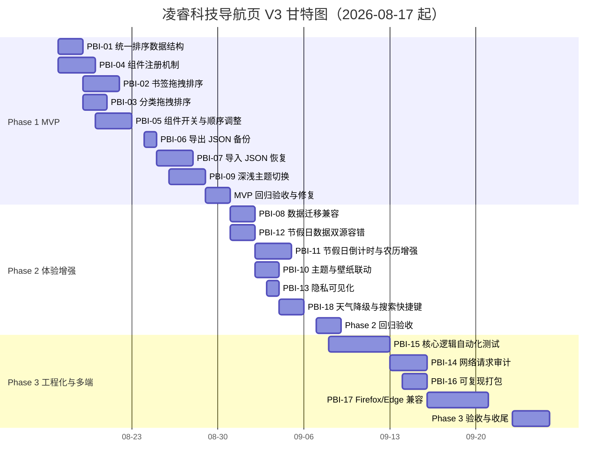

# 凌睿科技导航页 甘特图（Gantt Chart）

> 文档状态：v1.0 · 归属：凌睿科技导航页 · 关联：08-产品线路.md（Phase 1-3）、07-产品待办.md（PBI-xx）
> 时间基准：2026-08-17（周一）起，共 8 周；工作日为周一至周五
> **实际进度（2026-09-01 复核）：计划为 8 周（至 09-25），实际全部 PBI 已于 09-01 前完成
> （Phase 1 MVP 与 Phase 2 全部落地；Phase 3 的 PBI-15/14/16 完成、PBI-17 静态评估完成，
> 动态冒烟待 Firefox/Edge 环境）。里程碑 M1/M2 已达成，M3 除 PBI-17 动态验证外已达成。**

---

## Mermaid Gantt

---

## Markdown 表格版

| 周次 | 日期 | Phase | 任务（PBI） | 里程碑 |
|------|------|-------|-------------|--------|
| 第 1 周 | 08-17 ~ 08-21 | Phase 1 | PBI-01/04/02/03 | 数据结构与拖拽完成 |
| 第 1-2 周 | 08-21 ~ 08-24 | Phase 1 | PBI-05/06 | 组件开关 + 导出可用 |
| 第 2 周 | 08-24 ~ 08-28 | Phase 1 | PBI-07/09 | 导入 + 主题完成 |
| 第 2 周末 | 08-28 | Phase 1 | MVP 回归验收 | **里程碑 M1：MVP 交付** |
| 第 3 周 | 08-31 ~ 09-04 | Phase 2 | PBI-08/12/11/10/13/18 | 体验增强开发 |
| 第 4 周 | 09-07 ~ 09-08 | Phase 2 | 回归验收与修复 | **里程碑 M2：V3.1 完成** |
| 第 5 周 | 09-08 ~ 09-12 | Phase 3 | PBI-15 | 测试体系搭建 |
| 第 6 周 | 09-14 ~ 09-18 | Phase 3 | PBI-14/16 | 审计 + 打包 |
| 第 7-8 周 | 09-16 ~ 09-25 | Phase 3 | PBI-17 | 跨浏览器适配 |
| 第 8 周末 | 09-25 | Phase 3 | 全量验收 | **里程碑 M3：V3.2 完成** |

---

## 关键路径说明

1. **PBI-01 → PBI-02/03**：排序数据结构是拖拽的前提，串行。
2. **PBI-04 → PBI-05**：注册机制是组件开关的前提，串行。
3. **PBI-06 → PBI-07**：导出是导入的前提，串行。
4. **PBI-12 → PBI-11**：数据源容错先行，倒计时依赖稳定的节假日数据。
5. **PBI-15 → PBI-14/16**：测试体系是审计与打包的基础。

## 风险缓冲

- MVP 阶段在 08-28 前保留 1 个工作日缓冲（PBI-09 与导入可并行收尾）。
- PBI-17（跨浏览器）为最大不确定项（5d），若中途评估成本过高，可在里程碑 M3 前降级为"记录决策 + Chrome 单端"，不影响前两个里程碑。
