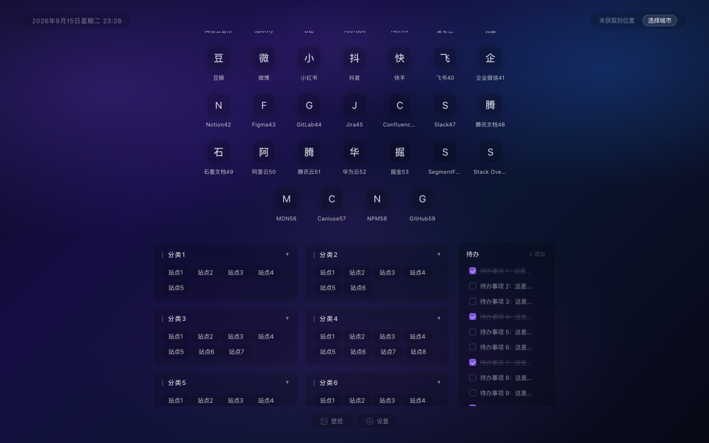
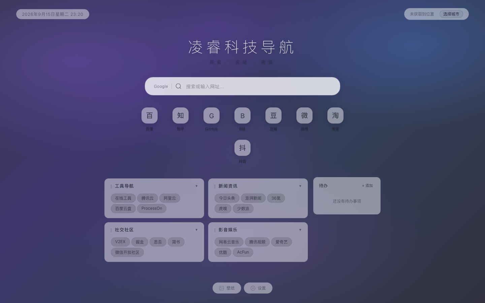
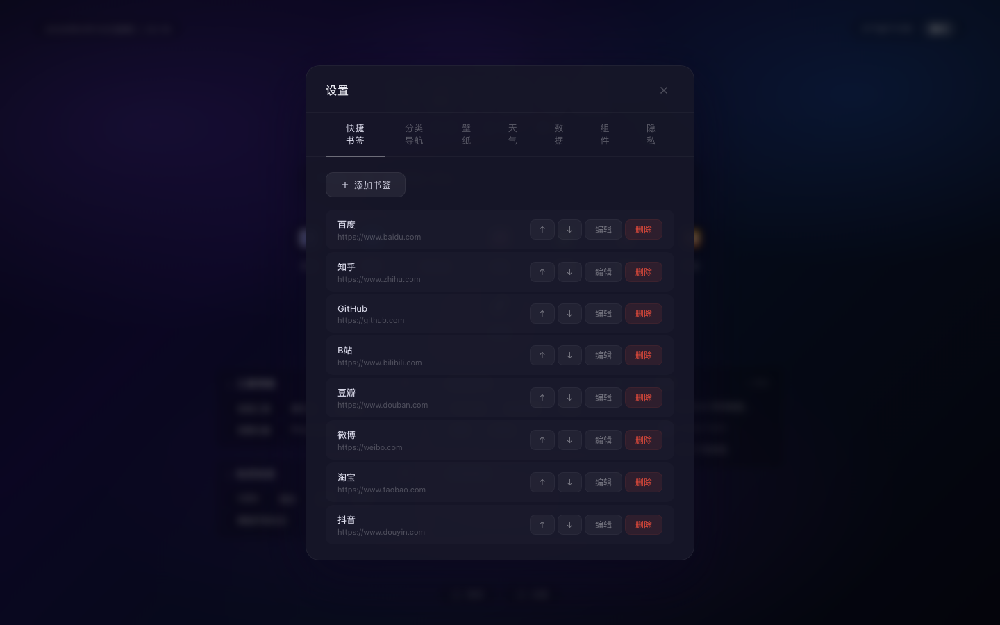

# 凌睿科技导航页 V4 使用体验优化方案

> 文档状态：**v2 已实施**（15 项主体落地，UX-12 右键菜单等 3 项增强/验证项见 §9.4）· 初稿 2026-09-15 · 归属：凌睿科技导航页
> 关联：05-PRD.md（V3 范围）、04-用户旅程地图.md、07-产品待办.md、`../reviews/项目评估报告.md`
> 方法说明：本方案的全部结论来自**真浏览器实测**（Chromium + Playwright，6 种视口，
> file:// 预览模式与 chrome-extension:// 扩展模式双验证），以及基于真实截图的像素级对比度采样。
> 凡未经实测的推断均在文中显式标注。

---

## 0. 结论速览

> **实施状态**：15 项主体完成（2026-09-15），3 项增强/验证项未做，见 §9.4。体验体检从
> **通过 11 / 不通过 19** 变为**通过 49 / 不通过 0**；需要注意体检**清单本身**也从 30 项
> 扩到 49 项，前后分母不同，不是同口径对比。
> **截至 2026-10-25 复测**：单测 91 项、E2E preview 131 项、shim 134 项、四模式合计 398 项全部通过。
> 下文 §9 记录的 64 / 123 / 126 / 374 为 2026-09-15 当时快照，保留作历史对照。
> 实施过程中另外发现并修复了一个 E2E 基础设施缺陷（见 §9.3）——它此前让**所有样式类断言
> 都测不到东西**，是三模式 E2E 长期存在的一个盲区。

V3 的功能面已经完整（搜索/书签/分类/待办/天气/农历/壁纸/设置/导入导出/隐私页），工程面也已达标
（单测 + 三模式 E2E + CI + 可复现打包）。**但"功能存在"与"体验可用"之间仍有明显落差**：
本次实测发现 4 项 P0 级缺陷，其中 UX-01 会在用户正常使用 2–4 周后必然发生，并让核心功能（搜索框）
从页面上彻底消失。

| 层 | 编号 | 问题 | 用户影响 | 工作量 |
|----|------|------|----------|--------|
| **P0** | UX-01 | 内容增长后搜索框被永久挤出视口，且无法滚动找回 | 核心功能消失，产品等于报废 | M |
| **P0** | UX-02 | 浅色主题下 8–9/10 关键元素对比度不达标（最低 1.34:1） | 功能交付了但实际不可读 | M |
| **P0** | UX-03 | 输入网址被当搜索词，placeholder 承诺未兑现 | 高频操作多一跳 | S |
| **P0** | UX-04 | 中文输入法选词回车直接跳走搜索 | 中文用户高频误触发 | XS |
| **P1** | UX-05 | 设置面板 7 个 tab 文字全部折成两行 | 首屏观感明显粗糙 | XS |
| **P1** | UX-06 | 书签换行后末行居中，与首行不对齐 | 视觉断层 | XS |
| **P1** | UX-07 | 待办卡片高度失衡，长列表无内部滚动 | 拖动整个页面布局 | S |
| **P1** | UX-08 | 待办删除无确认无撤销 | 误删不可恢复 | S |
| **P1** | UX-09 | 空状态只有一行小字，无行动入口 | 新用户不知下一步 | XS |
| **P1** | UX-10 | 无浏览器书签导入，新用户需手工录入几十条 | 上手阶段最大摩擦 | M |
| **P1** | UX-11 | 壁纸切换无任何反馈 | 不确定是否生效 | XS |
| **P2** | UX-12 | 主页无法快捷编辑书签（需四步进设置） | 日常维护成本高 | M |
| **P2** | UX-13 | `auto` 主题依赖静态 `themeHint`，无法适配任意壁纸 | 在线壁纸可能不可读 | S |
| **P2** | UX-14 | 深色主题下有 2–4 项次要文字落在 4.10–4.50:1 临界带 | 略低于无障碍标准 | XS |
| **P2** | UX-15 | 快捷键仅有 `/` 与 `Esc` | 键盘重度用户效率受限 | S |

**建议实施顺序**：UX-04 → UX-03 → UX-05 → UX-06 → UX-01 → UX-02 → UX-07/08/09 → UX-11 → UX-10 → P2。

---

## 1. 诊断方法与证据

### 1.1 验证环境

| 项目 | 取值 |
|------|------|
| 浏览器 | Chrome for Testing / chrome-headless-shell（ms-playwright 缓存版本） |
| 视口 | 1920×1080、1440×900、1366×768、1280×800、1024×768、900×700 |
| 模式 | `file://` 预览模式（localStorage 后端） + 扩展模式（`--load-extension`，已实测加载成功，扩展 ID `fkapmejgokgfcbkehkcklneoidjgccdm`） |
| 数据条件 | 预设数据（8 书签/4 分类/0 待办）、中度（30/6/8）、重度（60/12/15）；溢出检查用 8/14/21/28/35/40 书签梯度 |
| 主题条件 | dark / light × 深邃星空 / 极光绿 / 落日暖阳（6 组合；`auto` 在三张预设壁纸下均解析为 dark，不额外计一档） |
| 对比度 | 真实截图像素采样：背景取元素矩形内像素众数色，前景取 computed color（含祖先 opacity 累积），按 WCAG 2.1 相对亮度公式计算 |

> 扩展模式已验证 `autofocus` 生效（`document.activeElement === #searchInput`），
> 因此"打开即搜"**不需要**额外改动，本方案不含该项。

### 1.2 核心证据

**证据 A — 内容增长导致搜索框永久不可见（UX-01）**

| 书签 | 分类 | 待办 | 搜索框 top | `.main-content` 可滚动范围 | 结果 |
|------|------|------|-----------|--------------------------|------|
| 8 | 4 | 0 | 229 | 0px | ✅ |
| 14 | 6 | 3 | 164 | 38px | ✅ |
| 21 | 8 | 5 | 52 | 151px | ⚠️ 勉强 |
| **28** | **10** | **8** | **−61** | 263px | ❌ 滚到顶仍为 −61 |
| **35** | **12** | **12** | **−174** | 376px | ❌ 完全不可见 |

关键点：**把 `.main-content` 滚到最顶部（`scrollTop = 0`），搜索框 top 仍是 −61**。
即向上溢出的内容无法通过滚动到达，用户没有任何手段找回搜索框。



> 上图：60 书签 / 12 分类 / 15 待办时的实际渲染。标题与搜索框已完全消失，
> 书签首行被裁掉一半，待办列表底部内容被裁切且无法滚动——页面没有任何滚动条提示还有内容。

**证据 B — 主题 × 壁纸对比度实测（UX-02 / UX-14）**

浅色主题（以"深邃星空"为例，`tools/ux-audit.js --contrast` 输出）：

| 元素 | 实测对比度 | WCAG AA | 判定 |
|------|-----------|---------|------|
| 副标题 | 1.34:1 | ≥4.5 | ❌ |
| 书签名称 | 1.41:1 | ≥4.5 | ❌ |
| 日期时间 | 2.46:1 | ≥4.5 | ❌ |
| 底部按钮 | 2.45:1 | ≥4.5 | ❌ |
| 引擎按钮 | 3.14:1 | ≥4.5 | ❌ |
| 分类链接 | 3.12:1 | ≥4.5 | ❌ |
| 待办标题 | 3.68:1 | ≥4.5 | ❌ |
| 天气 | 3.91:1 | ≥4.5 | ❌ |
| 分类标题 | 4.45:1 | ≥4.5 | ❌（临界） |
| 主标题 | 7.23:1 | ≥3 | ✅ |

三种壁纸的 light 主题结果一致：8–9/10 不达标，最低 1.34–1.49:1。

深色主题同一清单只有 2–4 项不达标，且全部落在 4.10–4.50:1 的临界带：

| 元素 | 深邃星空 | 极光绿 | 落日暖阳 | 判定 |
|------|---------|--------|---------|------|
| 副标题 | 4.23:1 | 4.16:1 | 4.10:1 | ❌ |
| 日期时间 | 4.41:1 | 4.44:1 | 4.5:1 | ❌ |
| 引擎按钮 | 4.40:1 | 4.15:1 | 4.23:1 | ❌ |
| 底部按钮 | 4.47:1 | 4.5:1 | 4.5:1 | ⚠️ 视壁纸而定 |

即：**深色主题是"擦线"，浅色主题是"崩坏"**，两者根因不同（前者是 `--text-tertiary` 取值偏低，
后者是背景从未变亮）。

补充实测：仅把保底层不透明度从 0.16 提到 0.72，浅色主题仍有 7/10 不达标；
提到 0.86 并覆盖主要元素后仍有 6/10 不达标 —— 说明**背景提亮与文字 alpha 必须同时校准**，
不存在"一行修复"。



> 上图：浅色主题 + 预设壁纸"深邃星空"。卡片已变浅，但壁纸底仍是深色，
> 于是深色文字压在深色底上——"探索 · 发现 · 高效"、书签名称、分类标题几乎不可见。
> 这是当前任何一次"选浅色"操作都会得到的画面。

**证据 C — 交互行为实测**

| 场景 | 实测结果 |
|------|----------|
| 搜索框输入 `github.com` 回车 | 导航到 `google.com/search?q=github.com`（placeholder 承诺"输入网址"） |
| 搜索框 `isComposing=true` 时按 Enter | 仍触发搜索导航（同仓库 `todos.js:44` 已有 `!e.isComposing` 保护，搜索框漏改） |
| 设置面板 7 个 tab | 每个 tab 高度 64px（单行应约 40px），文字全部折行 |
| 待办删除按钮 | 点击即删，无确认、无撤销、无 toast |
| 壁纸按钮 | 切换后无任何 UI 反馈 |
| 键盘焦点序列 | `BODY → 日历翻月 → 天气 → 引擎按钮 → 搜索框`（首次 Tab 需经 3 个控件） |

---

## 2. P0 止血层

### UX-01 主页内容增长后搜索框永久不可见

**现象**：书签与分类积累到约 24–26 个后，搜索框开始被顶出视口；再多一些连标题也消失。
页面没有滚动条，用户无法找回。

**根因**：`.main-content`（`styles/main.css:355`）同时使用 `justify-content: center` 与
`overflow-y: auto`，而 `html, body` 是 `overflow: hidden`（`:233`）。这是 flexbox 的经典陷阱：
内容溢出时居中会向**两端**同时溢出，而滚动只能到达下方那一半，上方溢出的部分滚不到。

**方案**（最小改动，不动视觉语言）：
1. `.main-content` 的居中改为**溢出安全**的形式：`justify-content: flex-start`，
   再用首/末子元素的 `margin: auto` 吸收剩余空间。`margin: auto` 与
   `justify-content: center` 的关键差别是——**空间不足时它退化为 0，不会把内容推出容器**：

   ```css
   .main-content { justify-content: flex-start; }
   .main-content > :first-child { margin-top: auto; }
   .main-content > :last-child  { margin-bottom: auto; }
   ```
2. `.todo-list` 增加 `max-height` + `overflow-y: auto`，避免待办无限撑高主网格；
3. 让"内容可滚动"这件事本身可被发现：现有 `::-webkit-scrollbar-thumb` 在深色下是
   `rgba(255,255,255,0.08)`（对比度约 1.28:1，几乎看不见），且 light 下没有对应覆盖规则
   ——两种主题都需要一条可见的滚动条样式。

**已实测验证**（临时注入上述 CSS，1440×900，8 分类 + 8 待办）：

| 条件 | 搜索框 top | 标题 top | 结果 |
|------|-----------|---------|------|
| 8 书签 · 现状 | 99 | −20 | ❌ 标题不可见 |
| 8 书签 · 修复后 | 202 | 83 | ✅ 均可见 |
| 40 书签 · 现状 | −92 | −211 | ❌ 均不可见 |
| 40 书签 · 修复后 | 202 | 83 | ✅ 滚到顶后均可见 |
| 40 书签 · 待办列表 | — | — | scrollHeight/clientHeight 由 242/242 变为 242/240（出现内部滚动） |

> **修复后的体验边界**：内容确实超出视口时，搜索框需要滚动才能看到——但从"永久不可达"
> 变成"可滚动到达"。若希望搜索框**始终可见**，需要另立 P2 项（滚动时粘性搜索框，
> 或内容超限时自动进入紧凑模式），不在本层范围内。

**工作量**：M（涉及首屏布局，需全组件视觉回归）

**验收**：
- 新增 E2E 断言 `[28]`：注入 40 书签 / 12 分类 / 12 待办后，断言 `.search-box` 的
  `getBoundingClientRect().top >= 0` 且 `.bottom-bar` 不与 `.main-grid` 重叠；
- 区分性验证：把 `main.css` 回退到修复前版本，`[28]` 必须变红；
- 6 种视口各跑一遍（复用本次体检脚本的参数矩阵）。

---

### UX-03 补记（2.1.0）：直接访问从"后台判定"变成"看得见"

UX-03 落地时只在 `doSearch` 里做了判定，用户输入 `github.com` 回车会跳站，但输入过程中
界面没有任何提示——承诺兑现了，用户却不知道。2.1.0 按原型把搜索框下方那一行做成常驻提示：
默认给快捷键速查（`/` 聚焦、`Esc` 清空、`⌘K` 设置），输入形如网址时整行换成
「↗ 直接访问 github.com · 按 Enter 打开」。判定复用 `resolveInput`，与真正跳转同一口径，
不会出现"提示说会跳站、实际却去搜索"。提示行同时把 `⌘K` 变成真的快捷键。

### UX-07 接线修正（2.1.0）：待办卡不再与分类等高

UX-07 当时的解法是"待办卡跟左列等高 + 列表内部滚动"。但等高只解决了"右列下方有空洞"，
没解决"分类很多时待办卡被拉成一整条没有内容的卡片"。2.1.0 按原型改成**定高 236px +
内部滚动**，卡片高度只由自己的内容决定；分类列再长也不会把它拉变形。
E2E `[34]` 的判据随之从"等高"改为"保持定高、不随分类长高"。

### UX-02 浅色主题可读性系统性失效

**现象**：设置里选"浅色"后，副标题、书签名称、分类链接、日期时间等文字几乎看不见
（实测最低 1.34:1，10 项关键元素中 8–9 项不达标）。

**根因：两层错位，而不是"漏了几条覆盖"**（经静态完整性审查 + 实测双向确认）

*背景侧——从来没真正变亮：*
- `.bg-layer` 的背景由 `wallpaper.js:182` 用 `style.background` **内联写入**，
  样式表里的 `main.css:245-250` 实际被内联覆盖，**纯 CSS 唯一可控点是伪元素 `::after`**；
- `wallpaper.js:145-148` 同样用 `root.style.setProperty()` 把 `--accent-*` 写成 `<html>` 内联样式，
  优先级高于任何样式表规则 → `.todo-submit-btn`、`.todo-checkbox:checked`、`.dhc-cell.dhc-off`、
  `.dhc-cell.dhc-today` 在 light 下永远拿到深色主题的紫色，**CSS 覆盖无效**；
- 三个预设壁纸 `themeHint` 全为 `'dark'`、底色全为深色，而 light 只在 `::after` 叠
  `rgba(255,255,255,0.16)`（`main.css:41`）→ 页面底等效灰阶仅 40，卡片底 121。

*变量侧——覆盖本身也不成立：*
- `[data-theme="light"]` 的 10 条变量覆盖里**只有 4 条真正生效**
  （`--text-*` ×3 + `--shadow-md`）；`--glass-bg`、`--glass-bg-hover`、`--glass-border`、
  `--glass-border-hover`、`--shadow-sm`、`--shadow-lg` **引用次数为 0**，是死变量
  ——所有玻璃面板的背景/边框全部硬编码，从未走变量；
- `--text-tertiary` 在 light 下取 0.52，这个值**即使压在纯白底上也只有 3.63:1**，
  是取值本身的缺陷，与背景无关。

**方案**（按 R1→R7 顺序实施，其中 R1/R2 是其余各项生效的前提）：

| 编号 | 动作 | 位置 |
|------|------|------|
| R1 | `::after` 白纱 0.16 → **0.88 量级**，让 light 背景真的进入浅色区间 | `main.css:41` |
| R2 | 抬高文本变量：`--text-secondary` 0.74→0.80、`--text-tertiary` 0.52→0.64 | `main.css:29-30` |
| R3 | `--accent-*` 内联不可覆盖——或改 JS 按主题分两套色，或按 R6 用选择器级实色兜底 | `wallpaper.js:145` 或 CSS |
| R4 | 补齐 light 下**完全缺失**的硬编码覆盖：`.site-title`（L375 白字）、`.weather-sep`、`.todo-add-btn:hover`、`.tool-btn:hover`、`.category-link` 基础态、`.dhc-cell.dhc-work` 浅蓝、`.dhc-badge-*`、`.search-icon`/`.search-clear` 的 opacity 等 | `main.css` 各选择器 |
| R5 | 提高 light 下已覆盖但仍偏弱的 alpha（`.category-title` 0.85→0.92、`.todo-text` 0.62→0.72、`.dhc-*` 系列等 13 处） | `main.css` light 块 |
| R6 | accent 兜底实色：`.todo-submit-btn`、`.dhc-cell.dhc-off`、`.dhc-cell.dhc-today` | `main.css` |
| R7 | 设置面板：补 `.btn-danger` / `.btn-danger:hover` 覆盖（当前完全未覆盖），并提高 tab、`setting-item-url`、`section-desc` 等 7 处淡色文字 | `settings.css` |

> **强耦合警告**：R1 会立刻把 `.site-title`、`.weather-sep`、`.todo-add-btn:hover`
> 从"可读"变成"不可读"（白字压亮底约 1.2:1）。**R1 必须与 R4 同批落地**，
> 不能拆成两次提交，否则中间态比现状更差。

**工作量**：M（逐元素校准 + 3 壁纸 × 2 主题矩阵回归；若走 R3 的 JS 方案则上调为 M+）

**验收**：
- 新增 E2E 断言 `[29]`：在 3 壁纸 × {dark, light} 六个组合下，对固定元素清单做
  **像素背景 + computed color** 的对比度断言（≥4.5:1，大字号 ≥3:1）；
- 断言不能只检查 `data-theme` 属性值——该断言在缺陷存在时同样是绿的，属于无区分度断言；
- 区分性验证：回退 light 主题 CSS 块，`[29]` 必须变红。

**待定决策**：见 §5.1（保底层 vs 壁纸联动的取舍），以及 R3 走 CSS 兜底还是改 JS
（前者最小改动但把 accent 语义写死两遍，后者更干净但触及 `wallpaper.js` 的取色链路）。

> **后续（1.6.0 修订）**：R1 最终以"不透明纸面色"落地（1.2.6），代价是**浅色主题看不到壁纸**。
> 1.6.0 把它改成半透明纱罩：照片档中间段 0.64、预设渐变 0.34、内置默认图 0.95，
> 并给三张深色预设补了浅色版（`lightCss`）与书签名称的浅色加深。
> 换言之，本节 R1 的"0.88 量级"只适用于"没有壁纸"的前提；**现在的前提是壁纸可见**，
> 保底层强度必须按壁纸种类分档，且下限用"最不利局部"实测确定（见 `main.css` 的
> `.bg-layer::after` 注释与 CHANGELOG 1.6.0）。

> **后续（1.7.0 修订）**：用户要求"浅色把背景图也弄白，其余用 75% 毛玻璃"。
> 只加厚纱罩做不到"白"——照片暗部（岩壁阴影、夜景）再叠白纱也停在灰阶 180-200，
> 观感是"蒙了一层灰"。因此照片档改为**两层**：
> ① `.bg-layer` 上的 `filter: saturate(.38) brightness(1.42) contrast(.84)` 把照片本身
> 洗白（抬暗部、压平色阶、去色），② 纱罩（中间段 0.64 → 0.62）只负责收敛残余对比。
> 预设档不加滤镜：浅色渐变再提亮会整体过曝成纯白，晨雾白那层蓝紫会全丢。
> 表面材质同时从"单层实心纸片"改为 `--glass-1`（75% 白）+ `backdrop-filter:
> blur(26px) saturate(180%)`；浮层用 `--glass-2`（.88），悬停/聚焦只变实一档。
> **玻璃上不再叠玻璃**：设置面板内部小件、列表行、toast 保持实心纸片。
> 复测：浅色 × {纯黑最不利图, Bing 沙漠, Bing 红叶} 10 项全过（最差 8.31:1，纯黑图）；
> 4 预设 × 2 主题体检全过；E2E 新增 `[48]`（5 条）锁住玻璃计算样式与白化滤镜。

> **后续（1.8.0 修订，取代上一条的"两层"做法）**：用户要求"浅色模式下背景不要有任何
> 透明，只有元素是 75% 透明的玻璃材质"。纱罩这条路到此为止——**半透明覆盖层无论
> alpha 多低，都在把照片往纸白上"推"而不是"改写"**，观感始终是蒙灰。1.8.0 起：
> ① 浅色背景层删除全部纱罩（`::after` 恒 `background: none`），背景 alpha 恒为 1；
> ② 照片的白由 `.bg-layer` 上更彻底的不透明白化滤镜达成
> （`saturate(.18) sepia(.12) contrast(.1) brightness(1.96)`，全黑处灰阶 227）；
> ③ 预设档直接用 `lightCss` 渐变，不过滤镜；④ 半透明只属于元素（`--glass-1` 75%）。
> 这条确定了一个分工：**背景实心、元素半透明**。改动任何一侧都要看另一侧是否还成立。
> 复测：3 类背景 + 预设，浅色像素级对比度全过；`ux-audit --contrast` 8 组全过；
> E2E `[47]` 改为断言"无纱罩"、`[48]` 锁滤镜参数与 `::after` 透明。

> **再修订（1.9.0，最终形态）**：用户看完 1.8.0 的实机效果后的原话是"背景还是被一层
> 白色盖住了，我要背景清晰的显示，其他元素也清晰显示"。这说明 1.8.0 的"洗白"同样
> 落在同一个错误前提上——**只要还在处理背景，就一定在给背景加白**。
> 1.9.0 彻底换向：
> ① 照片一个像素都不改（`filter: none`，`::after` 仍无纱罩），Bing 壁纸的岩石纹理、
> 树叶、天空细节全部原样；
> ② 可读性改由元素承担：`--glass-1` 从 75% 提到 **86%**（照片原样后 0.75 会让卡片
> 被底下的红/绿染成脏粉、12px 正文掉到约 4.2:1），`saturate` 180% → 115%（模糊后的
> 光影不再被推色）；
> ③ **直压照片的文字加局部底片**：标题组用 74% 白胶囊（999px 圆角 + 负 margin 抵消
> 内边距），书签名称用 86% 白小圆角（`padding: 1px 7px` + 负 margin 保持居中）。
> 只在 api 档生效，预设渐变是浅底，不需要。
> 试过但否掉的方案：白色 `text-shadow` 光晕（亮照片上看不见、暗照片上变发光描边）。
> 复测：4 类背景（纯黑最不利 / 深蓝夜景 / Bing 石崖 / Bing 红叶）× 10 项关键元素
> 共 40 项全过，最低 4.89:1；`ux-audit --contrast` 8 组全过；E2E preview 161 /
> shim 164，均 FAIL=0。**这条确定的分工是：背景原样、元素半透明、直压照片的字自带底片。**

> **结项（2.0.0：浅色主题下线）**：1.9.0 的实机效果用户仍不满意——"浅色一直都不对，
> 干脆去掉浅色吧，看着不好看，只要深色的"。回看四版的做法（纱罩 / 提亮 / 洗白 / 原样+底片）
> 会发现它们都受同一个约束挤压：**浅色主题要在同一张照片上同时满足"背景清晰"与
> "深色 12px 正文可读"**，而照片的局部明暗是不可控的，任何折中都只能牺牲一边
> （前两版牺牲背景，后两版牺牲观感——标题胶囊、书签名底片像贴标签）。
> 2.0.0 的结论：**停止折中，只保留深色**。具体落地：
> ① 设置页移除「主题外观」分组，`Storage.normalizeAppearance()` 把存量 `light`/`auto`
> 归一为 `dark`（读与写都过一遍，手工改数据也写不进浅色）；
> ② 预设壁纸只留深色 `css`，`lightCss` 与浅色预设「晨雾白」删除；
> ③ 主题↔壁纸联动（PBI-10）与 `data-theme` 观察器移除，明度采样保留（压暗层强度仍按
> `data-wallpaper-tone` 分档）；
> ④ 样式表删掉 237 条 `[data-theme="light"]` 规则与 `--glass-*` 令牌。
> 结论沉淀成一条约束：**界面只有深色一套；背景层保持原样，不允许再叠加白色覆盖层或
> 白化滤镜**。E2E `[47]` 会直接扫样式表，出现浅色规则即红灯。
> 复测：单测 108；preview 147 / shim 150，均 FAIL=0；`ux-audit --contrast` 3 预设全过。

---

### UX-03 搜索框输入网址不能直接跳转

**现象**：placeholder 写着"搜索或输入网址..."，但输入 `github.com` 回车会跳到
`google.com/search?q=github.com`。

**根因**：`main.js:212` 的 `doSearch()` 无条件对输入做搜索引擎拼接，没有"这是不是一个网址"的判定。

**方案**：
1. 新增纯函数 `resolveInput(raw)`，返回 `{ type: 'url' | 'search', target }`；
2. 判定规则（按优先级）：
   - 已含 `http://` / `https://` → url；
   - `localhost` 或 `localhost:port` / `127.0.0.1` / 私有网段 IP / 带端口 IPv4 → url（补 `http://`）；
   - 形如 `域名.顶级域`（含 `.`、无空格、TLD 为 2–24 位字母、支持中文域名与末尾路径）→ url（补 `https://`）；
   - 其余 → search；
3. `doSearch()` 改为调用该函数；判定结果可在 UI 上给弱提示（如引擎按钮临时显示"打开"）。
4. **明确不做的**：不实现"根据历史自动学习"、不做搜索联想（无后端，YAGNI）。

**工作量**：S（纯函数 + 单测为主）

**验收**：
- 单测覆盖判定表：`github.com`、`https://a.b/c`、`localhost:3000`、`192.168.1.1`、
  `baidu.com/s?wd=x`、`如何学习 css`、`3.14`、`1.2.3`、空串、纯空格、
  超长串、含中文的域名与含中文的查询；
- 新增 E2E 断言 `[30]`：输入 `github.com` 回车后导航目标为 `https://github.com`；
- 区分性验证：回退 `doSearch()` 到旧实现，`[30]` 必须变红。

---

### UX-04 中文输入法回车误触发搜索

**现象**：用拼音输入"天气预报"，在候选词框按回车确认时，页面直接跳去 Google 搜索。

**根因**：`main.js:161-163` 的 `keydown` 只判断 `e.key === 'Enter'`，
没有判断 `e.isComposing`。同一仓库的待办输入框已经有这个保护（`todos.js:44`，P2-9 修复），
**搜索框漏改**——同类缺陷只修了一处。

**方案**：
1. 在搜索框的 Enter 处理中加入 `!e.isComposing` 判断（与 `todos.js` 口径一致）；
2. 顺带排查其余全部 `keydown/keypress` Enter 处理点，抽取共享的
   `isCommitEnter(e)` 工具函数（定义在 `storage.js` 旁的工具区），避免第三处再漏；
3. 补一条跨文件的同类检查：搜索框、待办输入、设置面板内联表单（书签/分类编辑、
   链接编辑）都要走同一判定。

**工作量**：XS

**验收**：
- 新增 E2E 断言 `[31]`：对 `#searchInput` 派发 `isComposing: true` 的 Enter 后，
  断言**未发生导航**；对照组（`isComposing: false`）断言发生导航；
- 区分性验证：回退 `main.js` 的 Enter 处理，`[31]` 必须变红；
- 同批断言覆盖设置面板内联表单的 Enter 提交。

---

## 3. P1 提效与观感层

### UX-05 设置面板 tab 文字全部折行

> **历史记录**：本节诊断的是 7 个 tab 时代的问题。1.2.5 起设置面板已收敛为 **4 个 tab**
> （内容 / 外观 / 天气 / 数据与隐私），下面的 padding 数值与验收口径都以当时 7 tab 为准，
> 不要据此复核现状。

**现象**：7 个 tab 全部折成两行——"壁纸"显示为"壁/纸"，"分类导航"显示为"分类/导航"。

**根因**：`.settings-tabs` 可用宽 504px（面板 560px − 左右 padding 28px×2），
`.tab-btn` 左右 padding 各 24px（`settings.css:213`），7 个 tab 光 padding 就占 336px，
留给文字的只有 168px（平均 24px/个）；而"快捷书签"需约 54px。

**方案**（最小改动，保留视觉风格）：`.tab-btn` 改为等分弹性布局：

```css
.tab-btn { flex: 1; padding: 13px 4px; white-space: nowrap; }
```

7 个 tab 等分 504px = 每个 72px；最宽的"快捷书签"按 13px 字号 + 0.4px 字距约需 54px，
加左右 padding 8px 共 62px，余量 10px。`white-space: nowrap` 是兜底——
即使后续加宽了文案也会溢出而不是折行，便于及早发现。
若后续新增第 8 个 tab（每个降到 63px），则改为"等分 + `overflow-x: auto` 横向滚动"。



> 上图：7 个 tab 全部折成两行——"壁纸"显示为"壁/纸"。实测每个 tab 高 64px
> （单行应约 40px），且与视口宽度无关（面板固定 560px）。

**工作量**：XS

**验收**：
- 新增 E2E 断言 `[32]`：断言每个 `.tab-btn` 的 `scrollHeight` 与其单行行高一致
  （即未折行），阈值用 `clientHeight <= lineHeight * 1.5`；
- 区分性验证：回退 `settings.css` 的 tab 规则，`[32]` 必须变红；
- 同时断言面板宽度 560px、1024×768 视口下同样不折行。

---

### UX-06 书签换行后末行居中错位

**现象**：8 个书签时首行 7 个、末行 1 个，且末行居中对齐（首行左 410px / 末行左 686px），
与首行形成视觉断层。

**根因**：`.links-grid`（`main.css:510`）是 `display: flex; justify-content: center; flex-wrap: wrap`，
换行后**每行独立居中**。容器 `.quick-links` 为 `max-width: 640px`，格子宽 68px + 间距 24px，
算得每行恰好放 7 个（7×68 + 6×24 = 620 ≤ 640，8 个需 712 放不下），
所以第 8 个起独占一行并居中，与首行左边界相差 276px。

**方案**（一处 CSS 改动即可，无需 JS）：
把 `.links-grid` 从 flex 换成**列对齐网格**：

```css
.links-grid {
  display: grid;
  grid-template-columns: repeat(auto-fit, 68px);  /* auto-fit：空轨道折叠，少量书签时网格自然收窄 */
  justify-content: center;                        /* 轨道整体居中，而非每行居中 */
  gap: 24px;
}
```

效果：≤7 个书签时轨道随数量收窄并整体居中（保持现状观感）；
8 个时生成 7 条轨道，第 8 个落在第二行第 1 列——与首行左边界严格对齐。
用 `auto-fit` 而非 `auto-fill`（后者不折叠空轨道，少量书签时会左偏）。
拖拽排序依赖 DOM 顺序，不受布局方式影响。

**已实测验证**（临时注入上述 CSS，1440×900）：8 个书签时首末行左边界差从 **276px → 0px**；
40 个书签（末行 5 个）从 **92px → 0px**。且与 UX-01 的布局修复互不干扰，可独立落地。

**工作量**：XS

**验收**：
- 新增 E2E 断言 `[33]`：注入 8 / 15 / 22 个书签，断言首行与末行第一个元素的 `left` 偏差 ≤2px；
- 区分性验证：回退 `.links-grid` 规则后 `[33]` 变红。

---

### UX-07 待办卡片高度失衡与长列表溢出

**现象**：默认数据下待办卡片高 111px，同排分类容器高 248px，右列留 141px 空白；
待办积累到 15 条时卡片高 521px，把整个主网格撑高，直接触发 UX-01 的溢出。

**根因**：`.todo-card` 无高度约束，`.todo-list` 无 `max-height`，
内容与分类网格是同一网格的不同行，互相牵动。

**方案**：
1. `.todo-list` 设 `max-height` + `overflow-y: auto`（滚动条样式复用现有规范）；
2. `.todo-card` 与相邻分类卡片对齐（`align-self: stretch`），空状态时保持最小高度，
   避免"矮一截"的视觉断裂；
3. 与 UX-01 一并回归，确保两种修复不互相抵消。

**工作量**：S

**验收**：
- 新增 E2E 断言 `[34]`：注入 20 条待办，断言 `.todo-card` 高度 ≤ 相邻分类卡片高度，
  且 `.todo-list` 出现内部滚动（`scrollHeight > clientHeight`）；
- 断言 0 条待办时 `.todo-card` 高度 ≥ 分类卡片高度的 60%（避免塌陷）。

---

### UX-08 待办删除无确认无撤销

**现象**：待办右侧 `×` 一点即删，无确认、无撤销，误删不可恢复。

**根因**：`todos.js:61-67` 直接调用 `Storage.deleteTodo(id)` 后重渲染。

**方案**：删除后显示 5 秒可撤销提示（toast："已删除「整理 Q3 复盘」· 撤销"），
撤销时用原数据恢复（复用 `Storage.addTodo` 并保持原 `createdAt` 以维持排序位置）。
不采用 `confirm()` 弹窗——打断性强且观感差。

**工作量**：S

**验收**：
- 新增 E2E 断言 `[35]`：删除后断言 toast 出现、5 秒内点击"撤销"后待办数量与内容完全还原
  （含 `createdAt` 顺序）；
- 断言超时后 toast 消失；
- 区分性验证：回退 `todos.js` 删除逻辑，`[35]` 必须变红。

---

### UX-09 空状态缺少行动入口

**现象**：清空书签/分类后，主页只显示一行小字（"还没有书签，点击底部「设置」添加"），
字号 11–12px、低对比度，且没有可直接点击的入口。

**方案**：
1. 空状态改为"图标 + 一句说明 + 主行动按钮"的组合；
2. 书签空状态提供两个按钮：**添加第一个书签**（直接打开设置的书签新增表单）、
   **从浏览器导入**（UX-10 落地后接入；未落地时隐藏该按钮）；
3. 分类空状态提供"添加第一个分类"；
4. 按钮复用 `.btn-primary` 样式，保证深浅主题一致。

**工作量**：XS（依赖 UX-10 的按钮为增量）

**验收**：
- 新增 E2E 断言 `[36]`：清空数据后断言空状态按钮存在、可点击，
  且点击后设置面板打开并定位到对应 tab；
- 断言空状态文案对比度达标（并入 `[29]` 的对比度检查清单）。

---

### UX-10 从浏览器一键导入书签

**现象**：新用户首次打开看到的是一套与自己无关的预设书签（8 条），
要变成自己的主页，只能逐条删除预设再逐条添加（每条 4 步）。

**根因**：`manifest.json` 仅申请 `storage` 权限，`chrome.bookmarks` 不可用
（扩展模式实测 `hasBookmarksApi: false`）。

**方案**（已确认采用可选权限路线）：
1. `manifest.json` 增加 `"optional_permissions": ["bookmarks"]` —— **不进入安装时的权限提示**；
2. 设置 → 数据 增加"从浏览器导入书签"按钮；点击时在**用户手势中**调用
   `chrome.permissions.request({ permissions: ['bookmarks'] })`；
3. 授权后调用 `chrome.bookmarks.getTree()`，**只读**，提供导入范围选择
   （仅书签栏 / 全部书签），导入为分类 + 链接；
4. 导入前自动备份（复用现有 `lastImportBackup-*` 轮转机制），导入后刷新主页；
5. 用户拒绝授权时给出明确引导文案，不重复弹窗骚扰；
6. **隐私页同步更新**：说明"仅在用户主动点击导入时读取浏览器书签，只读不写、不上传、
   不驻留权限之外的任何数据"。

**工作量**：M

**验收**：
- E2E shim 模式扩展 `chrome.permissions` / `chrome.bookmarks` 替身（注意替身异步特性必须
  保持宏任务实现，见 `nav-e2e.js` 中 `CHROME_STORAGE_SHIM` 的注释约定）；
- 新增 E2E 断言 `[37]`：授权路径断言书签数量增加且原有数据不丢；拒绝路径断言给出引导文案
  且数据不变；
- 新增单测覆盖"书签树 → 分类/链接"的转换纯函数（空树、深层嵌套、重复 URL、超长标题）；
- 扩展模式手动验证一次真实授权弹窗流程（E2E 无法覆盖系统权限弹窗）。

---

### UX-11 壁纸切换无反馈

**现象**：点击底部"壁纸"按钮，背景变化但没有任何文字提示，用户不确定切到了哪一张、
也不确定是否还有更多。

**方案**：切换后显示 2 秒轻提示（"壁纸：极光绿 · 3/5"），与 UX-08 的 toast 组件复用。

**工作量**：XS

**验收**：
- 新增 E2E 断言 `[38]`：点击壁纸按钮后断言提示出现、内容包含新壁纸名，2 秒后消失。

---

## 4. P2 增强层

### UX-12 主页快捷编辑书签

**现象**：改一个书签要从主页 → 设置 → 书签 tab → 编辑 → 保存，共 4–5 步。

**方案**（分两步走，第一步先做左侧）：
1. **常驻"+"磁贴 + 悬浮删除**：书签区末尾固定一个"+"磁贴，点击直接弹轻量新增表单
   （标题 + URL 两个字段，URL 粘贴后自动带出标题）；悬浮书签显示"×"，删除后走 UX-08 的撤销机制；
2. **右键 / 长按菜单**（增强）：提供"编辑 / 删除 / 移到分类 / 置顶"。

**工作量**：M（第 1 步 S，第 2 步 M）

**风险**：主页常驻控件增加会破坏"极简"观感——"+"磁贴需在无悬浮时保持低视觉权重
（低透明度、悬浮才提亮），并在设置中提供"隐藏快捷添加"开关。

---

### UX-13 `auto` 主题的壁纸明度识别

**现象**：`auto` 主题按壁纸的静态 `themeHint` 字段解析（`main.js:76-79`），
对 Bing 每日壁纸/随机壁纸只能依赖预置标记，壁纸本身明暗变化时无法自适应。

**方案**：对在线壁纸做**轻量明度采样**——图片加载完成后绘制到离屏 canvas，
降采样至 1×1 或 8×8 取平均亮度，低于阈值判定为深色壁纸。
注意跨域图片会污染 canvas，需 `crossOrigin` + 失败时回退到静态 `themeHint`。
**明确不做**：不做取色生成主题色（现有 `--accent-*` 体系保持不动）。

**工作量**：S

**验收**：单测覆盖亮度阈值判定纯函数；E2E 断言在线壁纸模式下 `auto` 解析结果与
采样亮度一致（用本地图片替身，避免外网依赖，遵守 P2 E2E 去外部依赖的既定约束）。

---

### UX-14 深色主题次要文字对比度微调

**现象**：深色主题下有 2–4 项次要文字落在临界带（副标题 4.10–4.23:1、
引擎按钮 4.15–4.40:1、日期时间 4.41–4.50:1，视壁纸而定），刚好压在 AA 阈值下方。

**根因**：`--text-tertiary` 取 `rgba(255,255,255,0.45)`——该值即使压在纯黑底上也只有约 4.5:1，
没有余量吸收壁纸渐变的局部提亮。

**方案**：把 `--text-tertiary` 提到 `0.50` 量级，逐项复测至 ≥4.5:1，
避免改动过大影响视觉层次（该变量同时用于日期、副标题、引擎按钮、底部按钮等 10 处）。

**工作量**：XS

**验收**：并入 `[29]` 的对比度清单，深色主题同样纳入断言（当前断言只覆盖浅色）。

---

### UX-15 快捷键体系扩展

**现状**：仅有 `/` 聚焦搜索、`Esc` 清空失焦（`main.js:181-193`）。

**方案**：增加
- `Esc` 在设置面板打开时关闭面板（当前需点右上角 ×）；
- `数字键 1–9` 打开第 N 个快捷书签（输入态下不拦截）；
- `?` 显示快捷键速查浮层（复用日历卡片的浮层模式）。

**工作量**：S

**验收**：E2E 断言各键位的目标行为；断言输入框聚焦时数字键不拦截。

---

## 5. 关键设计决策（需评审确认）

### 5.1 浅色主题修复路线

| 路线 | 做法 | 优点 | 缺点 |
|------|------|------|------|
| **A. 保底层（推荐）** | light 下把内容区背景提亮到浅色区间 + 校准文字 alpha | 一处生效、对任意壁纸有效、可测 | 壁纸被大幅提亮，"壁纸感"减弱 |
| B. 壁纸与主题强绑定 | 选 light 时自动切浅色壁纸 | 保留壁纸观感 | 三个预设壁纸全是深色 → light 下无壁纸可用 |
| C. 新增浅色壁纸预设 | 每个壁纸配深/浅双版本 | 观感与可读性兼得 | 工作量最大，需设计新素材 |

**推荐 A + C 组合**：先用 A 保证"任何组合都可读"（这是底线，可被断言覆盖），
后续按需补 1–2 张浅色预设壁纸提升观感上限。
注意实测结论：**只提亮背景不够**（0.72 时仍 7/10 不达标，0.86 时仍 6/10 不达标），
必须同时把 `--text-secondary` / `--text-tertiary` 在 light 下的 alpha 校准到 0.62/0.82 以上。

### 5.2 主页布局：溢出安全

`justify-content: center` + `overflow: auto` 的组合必须改。两种实现：
- `justify-content: safe center`：改动最小（一行），但需确认目标浏览器支持并保留降级；
- 内层 wrapper + `margin: auto`：兼容性最好，需增加一层 DOM。

推荐后者（兼容性优先，且项目无构建工具、不能在构建期做语法降级）。

### 5.3 搜索输入判定规则的边界

`1.2.3`、`3.14`、`文件名.txt` 这类输入到底算不算网址，需要明确：
- 判定为**搜索**（保守），避免把用户的搜索词误当网址跳走；
- 只有 TLD 在常见白名单内（com/cn/org/net/io/dev/app/…）或含协议/端口时才判定为网址。

此规则写入单测作为可执行规格。

### 5.4 optional_permissions 的时序与隐私边界

- `chrome.permissions.request()` **必须**在用户手势的同步调用栈中发起，不能在 `await` 之后；
- 权限只在用户主动点击"从浏览器导入"时申请，拒绝后不再自动弹窗；
- 导入是**只读**操作，不写回浏览器书签；
- 隐私页（`tabPrivacy`）需与 `manifest.json` 同步更新，并补 E2E 断言，
  避免"文档说没有权限、实际申请了"这类不一致（评估报告已确立该口径）。

### 5.5 `--accent-*` 内联样式的处理方式（UX-02 的 R3）

`wallpaper.js:145-148` 用 `root.style.setProperty()` 把强调色写成 `<html>` 内联样式，
CSS 永远覆盖不了。两条路：

| 路线 | 做法 | 优点 | 缺点 |
|------|------|------|------|
| **X. CSS 兜底（推荐先做）** | 在 light 下对 4 个依赖 accent 的选择器写死实色（`.todo-submit-btn`、`.todo-checkbox:checked`、`.dhc-cell.dhc-off`、`.dhc-cell.dhc-today`） | 不动 JS，风险低，可与 PKG-C 同批 | accent 语义被写死两遍，后续换壁纸取色需同步两处 |
| Y. 改 JS 分主题取色 | `applyColors` 读取当前 `data-theme`，按主题给两套 accent | 语义干净，一处生效 | 触及壁纸取色链路，需回归全部 accent 相关组件 |

推荐：先做 X 保证浅色主题达标（可被断言覆盖），把 Y 作为后续独立任务包。

---

## 6. 实施顺序与任务包拆分

按 `.agents/workflow.md` 的流程，建议拆成 5 个任务包，**文件交集为空**才可并行：

> **路径注记**：下表是 2026-09-15 当时的路径（`scripts/`、`scripts/__tests__/`）。2026-09-22
> 目录重组后对应关系为：`scripts/*` → `src/scripts/*`、`styles/*` → `src/styles/*`、
> `scripts/__tests__/e2e/nav-e2e.js` → `tests/e2e/nav-e2e.js`。保留原样是为了与当时的提交
> 记录对得上，**不要按此表直接找文件**。

| 包 | 内容 | 文件白名单 | 依赖 |
|----|------|-----------|------|
| PKG-A | UX-03 + UX-04（搜索判定与输入法） | `scripts/main.js`、`scripts/storage.js`（工具函数）、新增单测 | 无 |
| PKG-B | UX-01 + UX-07（布局溢出与待办滚动） | `styles/main.css` | 无 |
| PKG-C | UX-02 + UX-05 + UX-06 + UX-14（主题与视觉校准） | `styles/main.css`、`styles/settings.css` | 与 PKG-B 串行（同改 `main.css`） |
| PKG-D | UX-08 + UX-09 + UX-11（toast 与空状态） | `scripts/todos.js`、`scripts/main.js`、`styles/main.css` | 与 PKG-A/C 串行 |
| PKG-E | UX-10（书签导入） | `manifest.json`、`scripts/settings.js`、`index.html`、`scripts/storage.js`、`scripts/__tests__/e2e/nav-e2e.js` | 无（但 `nav-e2e.js` 与所有包的断言新增冲突，需串行合入） |

**串行约束**：所有包都要在 `scripts/__tests__/e2e/nav-e2e.js` 新增断言，
该文件是共用交集，必须由 root 串行合并；或改为"每个包先独立出断言草稿，
由 root 统一插入"。

**建议批次**：第 1 批 PKG-A（低风险、可立即验证）；第 2 批 PKG-B；第 3 批 PKG-C；第 4 批 PKG-D；第 5 批 PKG-E。

---

## 7. 验证方案

### 7.1 测试能力

1. **体验体检工具（本次已交付）**：`tools/ux-audit.js` —— 把本方案用到的四类测量
   （多视口布局与 tab 折行、内容量梯度溢出、主题×壁纸像素级对比度、交互行为）
   固化为一条可复跑命令，发现不达标项时退出码为 1，可直接接入 CI。
   它是构建期工具，位于仓库根 `scripts/` 下、不在扩展目录内，因此不进 `npm run pack` 分发包。
2. **仍需新增**：`chrome.permissions` / `chrome.bookmarks` 替身（扩展 shim 模式，
   异步特性必须保持宏任务实现，见 `nav-e2e.js` 中 `CHROME_STORAGE_SHIM` 的注释约定）；
   以及 PKG-E 的单测（书签树 → 分类/链接的转换纯函数）。

### 7.2 区分性验证要求（遵循 `.agents/rules.md`「验证有效性」）

每条新增断言都必须完成"回退被测代码 → 断言变红 → 恢复"的验证，并在报告中给出证据。
**特别提醒**：本方案的 UX-02 与 UX-05 最容易产生"无区分度断言"——
断言 `data-theme === 'light'` 或 tab 元素存在，在缺陷存在时同样是绿的。
必须断言**可读性/折行本身**（像素对比度、`clientHeight` 与行高的关系）。

### 7.3 生产条件匹配

| 维度 | 要求 |
|------|------|
| 存储后端 | UX-10 必须在 shim 模式（`chrome.storage`）验证，不能只跑 preview |
| 事件类型 | UX-04 必须用真实 `KeyboardEvent` 派发，不能用 `page.fill` 绕过 |
| 权限弹窗 | E2E 无法覆盖系统级权限弹窗，需在扩展模式手动验证一次并留存截图/日志 |
| 壁纸矩阵 | UX-02 必须跑 3 壁纸 × 2 主题全矩阵，单点观察不作数 |

---

## 8. 明确不做（Out of Scope）

- **搜索联想 / 搜索历史**：无后端，且涉及本地行为记录，与"无埋点"定位的解释成本不成比例。
- **云同步 / 账号体系**：`06-MVP.md` 3.2 既定排除项。
- **AI 组件、智能推荐**：同上。
- **Chrome 商店上架**：既定决策，非未完成项。
- **取色生成主题色**：现有 `--accent-*` 体系够用，避免引入壁纸主色提取的复杂度。
- **完整的键盘无障碍改造**（焦点陷阱、roving tabindex）：本次只做 UX-15 的有限快捷键，
  完整改造另立任务包。

---

## 附录 A：本次体检的可复现命令

体检能力已固化为仓库内的构建期工具（与 `tools/gen-city-coords.js` 同级，
不在扩展目录内，因此不进 `npm run pack` 分发包）：

```bash
node tools/ux-audit.js              # 全部检查（布局 / 溢出 / 对比度 / 交互 / 扩展模式）
node tools/ux-audit.js --layout     # 多视口布局与设置面板 tab 折行
node tools/ux-audit.js --overflow   # 内容量梯度下的溢出临界点
node tools/ux-audit.js --contrast   # 主题 × 壁纸像素级对比度
node tools/ux-audit.js --interact   # 网址直跳 / 输入法回车 / 待办撤销 / 壁纸反馈
node tools/ux-audit.js --extension  # 扩展模式加载与 autofocus（需 Chrome for Testing）
node tools/ux-audit.js --json       # 附加输出 JSON 结果
```

退出码：发现不达标项时为 1（可直接接入 CI），全部通过为 0。

> 测量口径说明：对比度采用「前景 = computed color（含祖先 opacity 累积）+ 背景 = 截图矩形内像素众数色」。
> 不采用"矩形内对比度最大的色簇"当前景——稀疏小字（如 letter-spacing 5px 的副标题）的抗锯齿像素
> 会被打散成大量低占比色簇，过滤后剩下的最大簇其实是背景的渐变变体，
> 会得出"深色主题下副标题只有 1.09:1"这种与事实相反的结论。该方法在本仓库实测踩过一次。

## 附录 B：证据强度声明

| 结论 | 证据类型 | 强度 |
|------|----------|------|
| UX-01 溢出临界点 | 梯度实测（6 组数据 × 5 视口） | 强（普遍结论） |
| UX-02 light 主题不达标 | 像素采样 + 3 壁纸 × 2 主题矩阵 | 强（普遍结论） |
| UX-14 dark 主题临界 | 同上矩阵，2–4 项落在 4.10–4.50 | 强 |
| UX-03 / UX-04 | 单点行为观察 + 代码事实 | 强（行为确定，与视口无关） |
| UX-05 / UX-06 / UX-07 | 尺寸实测（多视口一致） | 强 |
| UX-08 / UX-09 / UX-11 | 代码事实 + 交互实测 | 强 |
| UX-10 权限缺失 | 扩展模式实测 `hasBookmarksApi: false` | 强（代码事实） |
| UX-02 的 CSS 缺口清单（附录 C） | 静态审查 + 用 5 个实测锚点标定模型 | 中（推算，实施前需用 `--contrast` 复测复核） |
| UX-13 `auto` 对在线壁纸的解析 | **未实测**（需联网壁纸） | 弱（推断，实施前需补验证） |

## 附录 C：light 主题覆盖缺口清单（静态审查，供 PKG-C 直接施工）

> 来源：静态完整性审查（遍历两 CSS 文件全部颜色字面量 → 按图层次序 alpha 合成 → WCAG 计算），
> 用 5 个实测锚点标定模型后复算误差 ≤0.02。**数值为推算，落地时以 `ux-audit.js --contrast` 为准。**

**结构性结论（比单个选择器更重要）**
1. `[data-theme="light"]` 的 10 条变量覆盖中，**6 条落在零引用变量上**
   （`--glass-bg`、`--glass-bg-hover`、`--glass-border`、`--glass-border-hover`、`--shadow-sm`、`--shadow-lg`）
   —— 所有玻璃面板背景/边框均硬编码，改变量不会有任何效果。这是"改了 light 却看不出变化"的直接原因。
2. `--accent-*` 由 `wallpaper.js:145-148` 内联写入，**CSS 覆盖一律无效**；
   `.todo-submit-btn`、`.todo-checkbox:checked`、`.dhc-cell.dhc-off`、`.dhc-cell.dhc-today`
   在 light 下永远拿到深色主题的紫色。
3. `.bg-layer` 背景同样由 JS 内联（`wallpaper.js:182`），**纯 CSS 唯一可控点是 `::after`**。

**A 类：已变量化、light 也改了色，但背景仍旧深色 → 实际不可读**
`.site-subtitle`、`.bookmark-title`、`.empty-hint`、`.datetime`、`.weather-widget`、
`.weather-temp`、`.weather-desc`、`.category-title`、`.category-toggle`、`.category-link`、
`.todo-title`、`.todo-text`、`.todo-text.done`、`.todo-empty`、`.todo-checkbox`、`.todo-delete-btn`、
`.feedback-error`、`.feedback-success`、`#searchInput::placeholder`、`.engine-btn`、`.tool-btn`、
`.todo-input::placeholder`、`.dhc-nav`、`.dhc-week`、`.dhc-sub`、`.dhc-weekend`、`.dhc-cell.dhc-outside`、
`.dhc-source-note`、`.bookmark-icon.fallback`、`.search-icon`、`.search-clear`、`.tool-btn svg`

**B 类：写死在选择器里、light 完全没有覆盖**
`html/body` 背景、`.bg-glow`、`.site-title`（硬编码白字）、`.weather-sep`、
`.todo-add-btn:hover`、`.tool-btn:hover`、`.category-link` 基础态、`.category-header:hover`、
`.todo-checkbox:checked::after`、`.todo-submit-btn`、`.main-content` 滚动条、`.whc-bar`、
`.dhc-cell:hover`、`.dhc-cell.dhc-off`、`.dhc-cell.dhc-work`、`.dhc-cell.dhc-today`、
`.dhc-badge-off`、`.dhc-badge-work`

**C 类：settings.css（面板底已是近白，与背景修复无关，可独立落地）**
- `.btn-danger` 与 `.btn-danger:hover` **完全未覆盖**（红色按钮在浅底上仅 2.04–3.08:1）；
- 需提亮的淡色文字 7 处：`.tab-btn`（未选中态 2.79:1）、`.settings-close`、`.btn-edit`、
  `.setting-item-url`、`.setting-section-desc`、`.empty-state`、输入框 placeholder。

---

## 9. 实施结果（2026-09-15）

### 9.1 交付清单

| 编号 | 内容 | 主要文件 | 配套断言 |
|------|------|----------|----------|
| UX-01 | 主页布局溢出安全（`margin:auto` 替代 flex 居中）+ 待办列表内部滚动 | `styles/main.css` | E2E `[28]` |
| UX-02 | 浅色主题补齐（路线 A 保底层 + 变量校准 + 30 余处覆盖；路线 C 新增浅色预设壁纸） | `styles/main.css`、`settings.css`、`scripts/wallpaper.js` | E2E `[29]` `[43]` |
| UX-03 | 搜索框网址直跳（`resolveInput` 判定表 + TLD 白名单） | `scripts/main.js` | 单测 12 项 + E2E `[30]` |
| UX-04 | 输入法合成期间回车不提交（`isCommitEnter` 共用判定） | `scripts/storage.js`、`main.js`、`todos.js` | 单测 3 项 + E2E `[31]` |
| UX-05 | 设置面板 tab 等分布局，不再折行 | `styles/settings.css` | E2E `[32]` |
| UX-06 | 书签区改 `auto-fit` 网格，末行与首行左对齐 | `styles/main.css` | E2E `[33]` |
| UX-07 | 待办卡片与分类容器等高 + `max-height` 内部滚动 | `styles/main.css` | E2E `[34]` |
| UX-08 | 待办删除可撤销（新增 `Storage.restoreTodo` + toast 组件） | `scripts/toast.js`（新增）、`todos.js`、`storage.js` | E2E `[35]` |
| UX-09 | 空状态行动入口（直达新增表单） | `scripts/main.js`、`styles/main.css` | E2E `[36]` |
| UX-10 | 从浏览器导入书签（`optional_permissions` + 树转换纯函数） | `manifest.json`、`settings.js`、`storage.js` | 单测 10 项 + E2E `[37]` |
| UX-11 | 壁纸切换文字反馈 | `scripts/main.js`、`toast.js` | E2E `[38]` |
| UX-12 | 主页快捷添加磁贴 + 悬浮删除（可撤销）+ 设置页开关 | `scripts/main.js`、`storage.js`、`settings.js`、`styles/main.css` | E2E `[40]` `[42]` |
| UX-13 | `auto` 主题按在线壁纸明度自适应（**`` + canvas 采样为主，`fetch` 仅兜底**——改回纯 fetch 会让随机壁纸源静默失效，见 AGENTS.md「改动壁纸明度采样时」ADV-05） | `scripts/wallpaper.js` | E2E `[39]` |
| UX-14 | 深色主题 `--text-tertiary` 0.45 → 0.52 | `styles/main.css` | E2E `[29]` |
| UX-15 | 数字键 1-9 打开书签 + `?` 快捷键速查 | `scripts/main.js` | E2E `[41]` |

### 9.2 实测数据对比

> **以下全部是 2026-09-15 的快照**，不是现状。当前值见本文开头 §0 与 `AGENTS.md`「常用命令」：
> 体检 49/0、单测 91、preview 131、shim 134、四模式 398。表中的 46/0、64、123、126、374
> 保留原值以便与当时的实施记录对账。

| 指标 | 实施前 | 实施后 |
|------|--------|--------|
| 体验体检（`node tools/ux-audit.js`） | 通过 11 / **不通过 19** | 通过 46 / **不通过 0** |
| 40 书签时搜索框位置 | top = **−222**（滚到顶仍是 −222） | top = **202**（可见，可滚 848px 查看其余内容） |
| 浅色主题不达标元素 | 8–9 / 10 | **0 / 10**（4 壁纸 × 2 主题全矩阵） |
| 深色主题不达标元素 | 2–4 / 10 | **0 / 10** |
| 设置面板 tab 行数 | 7 个全部两行（高 64px） | 7 个全部单行 |
| 书签末行左边界差 | 276px | **0px** |
| 待办卡片 vs 分类容器 | 111px vs 248px | **248px vs 248px** |
| 单测 | 42 项 | **64 项** |
| E2E（preview / shim） | 82 / 93 项 | **123 / 126 项**（四模式合计 374 项） |

### 9.3 实施中发现的四个测试盲区

**其一：E2E 静态服务器的 MIME 类型错误。**

`nav-e2e.js` 的内嵌静态服务器此前对所有非 `.json` 文件一律返回
`Content-Type: text/html`（含 `.css` 与 `.js`）。Chrome 在标准模式下会拒绝应用 MIME 不是
`text/css` 的样式表——**preview 与 shim 两种模式的页面完全没有样式**。

后果之所以隐蔽：所有只测 DOM 与行为的断言照常全绿（`Storage`、`App` 等仍是可用的），
而任何样式相关的回归都测不到。本次新增的 `[28][32][33][34]` 第一次运行全部失败，
排查后才定位到这里——**在修好 MIME 之前，这类断言永远不可能通过**。

修复后原有 82 项断言无一回归，说明它们确实与样式无关；同时新增的样式断言开始真正生效。
这也意味着：**扩展模式与 file:// 模式（MIME 由 Chrome 按扩展名推断）一直是正确的，
只有 preview/shim 这条最常用的 headless 路径在"裸奔"**。

**其二：一条会自己变绿的断言。**

`[42] 撤销后书签回到原位` 初版写成
`JSON.stringify(afterUndo) === JSON.stringify(before)`。回退被测代码后，
`evaluate` 在找不到删除按钮时返回 `{ error: … }`，两个字段都是 `undefined`，
而 `JSON.stringify(undefined) === JSON.stringify(undefined)` **恰好为真**——
这条断言在功能完全缺失时反而是绿的。`[35]`（待办撤销）有同样的写法与同样的隐患。

修法是给断言加前置条件（`!error && Array.isArray(before) && before.length > 0`）。
修正后重新回退验证，`[42]` 的 7 条断言全部变红。
**这类"两边都是 undefined 所以相等"的假绿，只有真正回退一次才会暴露**——
这也是为什么 `.agents/rules.md` 要求断言必须有区分度，而不能只看它是否通过。

**其三：DOM `click()` 绕过了指针可达性。**

`[42]` 的删除流程初版用 `page.evaluate(() => btn.click())` 触发。它能通过，
但**证明不了按钮真的能点**——悬浮删除按钮平时是 `pointer-events: none`，
只有 cell 被 hover 时才对指针开放；DOM `click()` 直接派发事件，完全绕过这一层。
换成真实鼠标操作（`page.hover(cell)` 再 `page.click(btn)`）后立刻暴露出
Playwright 的可点性检查确实在意这件事，测试也才真正覆盖了用户路径。

这正是 `.agents/rules.md`「验证条件与生产不符」那一类：**真实点击 vs 合成 `click()`**
在本项目历史上已经造成过一次误判（P0-1 编辑表单重复 ID 在两种路径下行为相反）。
`[42]` 现在同时断言"真实鼠标点击确实删掉了那一条"，把这条路径钉住。


**其四：断言没有真正建立自己要验证的前置条件。**

`[43] 浅色壁纸 + 深色主题下关键文字仍达标` 初版用
`Storage.updateSettings({ theme: 'dark' })` 切主题，但**没有调用 `App.applySettings`** ——
`updateSettings` 只写存储，`data-theme` 不会自己变。于是页面停留在上一条用例遗留的
`light` 主题上，这条断言实际测的是"浅色壁纸 + 浅色主题"（本来就可读），
**在保底层规则被删掉的情况下依然报绿**。

它是怎么暴露的：做区分性验证时先回退壁纸、再只回退 CSS 规则，两步跑下来结果不一致，
顺手用 `ux-audit --contrast` 复核才发现真实情况是 10/10 不达标。

修法有两处：显式 `App.applySettings(await Storage.getSettings())` 真正切主题；
并把 `theme === 'dark' && tone === 'light'` 写进断言的前置条件——
这样"条件没建立"会直接判失败，而不是伪装成通过。
**断言不仅要验证结果，还要验证自己确实处在要验证的条件下。**

### 9.4 未完成项（如实记录）

1. **UX-12 的"右键/长按菜单"未做**：方案把它列为第二步（增强项）。本次已完成
   悬浮删除（含 5 秒撤销）与设置页开关；右键菜单的"编辑 / 移到分类 / 置顶"仍未实现。
2. **UX-15 的"Esc 关闭设置面板"**：该能力原本已存在（`settings.js` 的 Escape 处理），
   本次只新增了数字键与 `?` 速查。
3. **扩展模式的真实权限弹窗未人工验证**：`[37]` 在 shim 模式用替身覆盖了授权/拒绝两条路径，
   但真实的 `chrome.permissions.request` 系统弹窗 E2E 无法驱动，需要人工点一次确认。
   代码侧的约束（申请必须在用户手势的同步调用栈中发起）已通过"前置无 await"的写法保证。

### 9.5 可复现的验证命令

```bash
npm test                    # 64 项单测（含 UX-03/04/10 的纯函数判定表）
npm run test:e2e            # 四模式全量：374 项通过（preview + file:// + shim + 真实扩展）
npm run test:e2e:preview    # 123 项（http 预览模式）
npm run test:e2e:shim       # 126 项（chrome.storage / permissions / bookmarks 替身）
node tools/ux-audit.js    # 体验体检：46 项通过 / 0 项不通过（不达标时退出码 1）
npm run pack                # 单测 + 可复现打包（19 个文件，含新增 toast.js，自校验通过）
```

> 扩展模式（真实 Chrome for Testing + `--load-extension`）本次也在 headless 下跑通，
> 验证了 newtab 被扩展接管、autofocus 生效。`[37]` 在该模式下按设计跳过——
> 真实 `chrome.permissions.request` 会弹系统授权框，E2E 无法驱动。
> 判据用的是"能否申请权限"（`permissions.request`）而非"能否读书签"（`chrome.bookmarks`）：
> 后者在未授权时根本不存在，用它判断会让扩展模式误入降级分支去弹真实授权框。

每批改动都完成了 `.agents/rules.md` 要求的**区分性验证**：回退被测代码后确认对应断言变红、
对照组保持绿色，再恢复。例如：
- 回退 `resolveInput` 的实现 → 6 项单测变红；反向回退（什么都当网址）→ 5 项变红，
  证明判定表在"漏判"和"误判"两个方向都有守护；
- 回退浅色主题 CSS → `[29]` 在 light 下报出 7 项不达标；
- 回退 `[37]` 的导入前备份 → 备份断言拿到的是 `importData` 顺手写下的那份，随即变红
  （这条断言初版确实没有区分度，是在验证过程中发现并修正的）。
