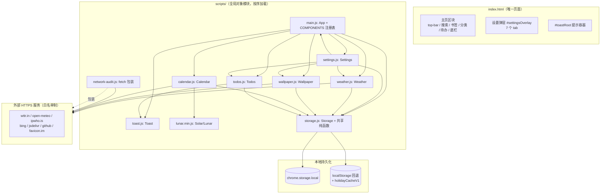
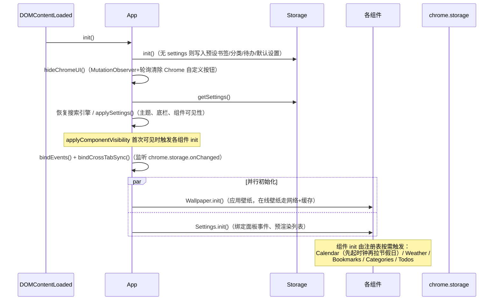
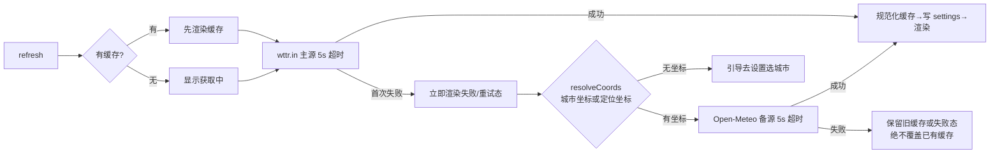

# 凌睿科技导航页 · Code Wiki

> 本文档是对仓库代码的结构化导览：整体架构、模块职责、关键对象与函数、数据模型、
> 依赖关系、运行与测试方式。面向首次接手本仓库的开发者与 AI 编程代理。
> 内容基于源码逐文件核对，最后更新对应版本 **1.1.3**。
> 产品背景与需求文档见 `docs/product/`，评估与审查记录见 `docs/reviews/`。

---

## 目录

1. [项目概览](#1-项目概览)
2. [目录结构](#2-目录结构)
3. [整体架构](#3-整体架构)
4. [启动流程与脚本加载顺序](#4-启动流程与脚本加载顺序)
5. [运行时模块详解](#5-运行时模块详解)
   - [5.1 storage.js — 数据层](#51-storagejs--数据层)
   - [5.2 main.js — 应用主控](#52-mainjs--应用主控)
   - [5.3 settings.js — 设置面板](#53-settingsjs--设置面板)
   - [5.4 weather.js — 天气（双源容灾）](#54-weatherjs--天气双源容灾)
   - [5.5 wallpaper.js — 壁纸与主题联动](#55-wallpaperjs--壁纸与主题联动)
   - [5.6 calendar.js — 农历日历与节假日](#56-calendarjs--农历日历与节假日)
   - [5.7 todos.js — 待办](#57-todosjs--待办)
   - [5.8 toast.js — 操作反馈](#58-toastjs--操作反馈)
   - [5.9 network-audit.js — 网络白名单审计](#59-network-auditjs--网络白名单审计)
   - [5.10 lunar.min.js — 第三方农历库](#510-lunarminjs--第三方农历库)
6. [数据模型与存储](#6-数据模型与存储)
7. [UI 结构与样式体系](#7-ui-结构与样式体系)
8. [外部网络依赖](#8-外部网络依赖)
9. [关键机制与数据流](#9-关键机制与数据流)
10. [安全防护设计](#10-安全防护设计)
11. [测试体系](#11-测试体系)
12. [构建与打包](#12-构建与打包)
13. [本地运行与常用命令](#13-本地运行与常用命令)
14. [常见开发任务指引](#14-常见开发任务指引)

---

## 1. 项目概览

| 项 | 内容 |
|----|------|
| 产品 | 凌睿科技导航页 —— 浏览器新标签页（New Tab）扩展 |
| 平台 | Chrome Extension **Manifest V3**（Edge 等 Chromium 浏览器同样可加载） |
| 技术栈 | 原生 HTML / CSS / JavaScript，**无前端框架、无运行时构建步骤** |
| 数据 | 全部保存在本地（`chrome.storage.local`，`localStorage` 回退）；无后端、无账号、无云同步、无埋点 |
| 当前版本 | 1.1.3（版本号以 `src/manifest.json` 为准） |
| 分发形态 | 直接加载 `src/` 目录；或用 `npm run pack` 生成 `dist/凌睿科技导航.zip` |

**功能一览**：搜索框（Google/百度/Bing 切换、网址直跳、快捷键）、快捷书签（增删改、
拖拽排序、favicon、主页悬浮删除可撤销、从浏览器导入）、分类导航（折叠、两级增删改）、
待办（可撤销删除）、农历日历浮层（节气/干支/法定节假日倒计时）、天气（wttr.in 主源 +
Open-Meteo 备源、24 小时曲线、城市选择/IP 定位）、壁纸（4 套预设渐变 + Bing 每日 +
随机在线图、明暗采样联动主题）、深/浅色主题、组件显隐管理、JSON 备份导入导出、隐私声明。

**架构风格**：单页面 + 多个按固定顺序加载的普通 `<script>`，模块间通过**全局对象**
（`Storage` / `App` / `Settings` / `Weather` / `Wallpaper` / `Calendar` / `Todos` /
`Toast`）协作；每个文件同时支持 Node 环境 `module.exports`（供单元测试 require），
顶层无浏览器副作用，故同一文件可在浏览器与 Node 双环境运行。

---

## 2. 目录结构

```
浏览器导航页/
├── src/                        # ★ 扩展本体，Chrome 直接加载此目录
│   ├── manifest.json           # MV3 清单：newtab 覆盖、权限、CSP、host_permissions
│   ├── index.html              # 唯一页面（主页 + 设置弹层骨架），按序加载 10 个脚本
│   ├── scripts/                # 运行时 JS（详见第 5 节）
│   │   ├── network-audit.js    # 网络白名单与 fetch 审计（最先加载）
│   │   ├── storage.js          # 数据层：预设数据、CRUD、备份、串行化、共享工具函数
│   │   ├── toast.js            # 轻量提示（支持撤销动作）
│   │   ├── wallpaper.js        # 壁纸注册表、在线壁纸、明度采样与主题联动
│   │   ├── weather.js          # 天气双源、码表、定位、缓存、悬浮曲线
│   │   ├── lunar.min.js        # 第三方 lunar-javascript（全局 Solar/Lunar/HolidayUtil）
│   │   ├── calendar.js         # 公历/农历/节假日日历浮层
│   │   ├── todos.js            # 待办渲染与交互
│   │   ├── settings.js         # 设置面板（7 个 tab 的全部逻辑）+ normalizeUrl
│   │   └── main.js             # App 主控：组件注册表、搜索、书签/分类渲染、启动
│   ├── styles/
│   │   ├── main.css            # 主页全部样式（约 1800 行，18 个分区）
│   │   └── settings.css        # 设置面板样式
│   ├── data/
│   │   └── cities.json         # 省份→城市（拼音 query + 经纬度），天气备用源坐标数据
│   ├── images/icons/           # 16/48/128 扩展图标
│   └── THIRD-PARTY.md          # 第三方组件与数据服务条款声明
├── tests/
│   ├── unit/                   # node:test 单元测试（8 个文件，79 项）
│   │   ├── storage.test.js
│   │   ├── sorting.test.js
│   │   ├── search-input.test.js
│   │   ├── weather.test.js
│   │   ├── wallpaper.test.js
│   │   ├── calendar.test.js
│   │   ├── bookmark-import.test.js
│   │   └── network-audit.test.js
│   └── e2e/
│       └── nav-e2e.js          # Playwright E2E：extension/preview/file/shim 四模式
├── tools/                      # 构建期与检查脚本（不进分发包）
│   ├── pack.js                 # 零依赖手写 zip 的可复现打包
│   ├── ux-audit.js             # 体验体检：布局/溢出/对比度/交互/空状态
│   └── gen-city-coords.js      # 调 Open-Meteo Geocoding 重建 cities.json 经纬度
├── docs/                       # 产品文档、评估报告、过程记录
├── .agents/                    # 多 AI agent 协作规范
├── .github/workflows/ci.yml    # CI：单测+覆盖率+preview/shim 两种 E2E
├── package.json                # 仅一个 devDependency：playwright
├── AGENTS.md                   # AI 代理协作入口（含命令清单与高危改动注意事项）
└── CHANGELOG.md                # 版本约定与变更记录
```

测试与工具全部位于 `src/` 之外，天然不会进入分发包。

---

## 3. 整体架构

### 3.1 分层视图



### 3.2 架构要点

- **无模块打包器**：脚本靠 `<script>` 顺序加载共享全局命名空间。加载顺序即依赖顺序
  （见第 4 节）；少数“前向引用”（如 `settings.js` 使用 `main.js` 定义的 `COMPONENTS`、
  `weather.js` 弱引用 `Settings`）只出现在函数体内，运行时所有脚本已就位，并有
  `typeof X !== 'undefined'` 守卫。
- **数据层单一入口**：所有持久化读写都经过 `Storage` 对象；UI 层不直接碰
  `chrome.storage`（节假日缓存 `holidayCacheV1` 是唯一例外，由 calendar.js 直接写
  localStorage）。
- **渲染范式**：字符串模板 + `innerHTML` 全量重渲染为主，拖拽排序用 DOM 移动避免
  favicon 闪烁；所有插入文本经 `escapeHtml` / `escapeAttr` 转义。
- **双环境模块**：每个自研脚本末尾的
  `if (typeof module !== 'undefined' && module.exports)` 导出纯函数与对象，
  使 `node:test` 可以直接 require 业务代码。
- **组件化**：主页区块由 `main.js` 的 `COMPONENTS` 注册表统一管理，HTML 上以
  `data-component="<id>"` 锚点关联，可见性持久化在 `settings.componentVisibility`。

---

## 4. 启动流程与脚本加载顺序

`index.html` 底部按以下顺序加载（顺序不可随意调整）：

| 序 | 脚本 | 加载时副作用 |
|----|------|-------------|
| 1 | network-audit.js | 浏览器环境立即 `installAudit()` 包装 `window.fetch` |
| 2 | storage.js | 仅定义常量与 `Storage`（写方法在加载末尾被串行化包装） |
| 3 | toast.js | 无 |
| 4 | wallpaper.js | 无 |
| 5 | weather.js | 无 |
| 6 | lunar.min.js | UMD：挂全局 `Solar` / `Lunar` / `HolidayUtil` 等 |
| 7 | calendar.js | 末尾 `window.Calendar = Calendar` |
| 8 | todos.js | 无 |
| 9 | settings.js | 定义 `Settings` 与 `normalizeUrl` |
| 10 | main.js | 注册 `DOMContentLoaded → App.init()` |

`App.init()` 时序（main.js）：



组件首次变为可见时执行一次 `init()`；之后每次显示/隐藏触发可选的
`onShow()` / `onHide()`（天气用它启停 30 分钟定时器，保证“隐藏组件即停止网络请求”）。

---

## 5. 运行时模块详解

### 5.1 storage.js — 数据层

仓库最核心的模块。职责：预设数据、存储后端适配、全部 CRUD、排序、备份导入导出、
写操作串行化，以及一批被全项目共享的纯工具函数。

#### 常量与预设

- `PRESET_BOOKMARKS`：8 个内置快捷书签（百度/知乎/GitHub/B 站…）。
- `PRESET_CATEGORIES`：4 个内置分类（工具导航/新闻资讯/社交社区/影音娱乐），共 20 条链接。
- `DEFAULT_SETTINGS`：默认设置（壁纸“深邃星空”、搜索引擎 Google、深色主题、
  `showBottomBar/showQuickAdd` 为真、`componentVisibility: {}`、`version: '1.0.0'`）。
- `SUPPORTED_SCHEMA_VERSION = 1`：备份格式版本闸门。

#### 共享纯函数（被其他模块直接当全局函数调用）

| 函数 | 职责 |
|------|------|
| `generateId()` | 时间戳 36 进制 + 随机串生成条目 id |
| `reorder(items, from, to)` | 纯函数数组搬移，越界返回拷贝，不改入参 |
| `ensureSortOrder(items)` | 存量数据缺 `sortOrder` 时按当前顺序补 1..n，返回是否补值 |
| `validateBackup(data)` | 备份 JSON 全量校验，返回中文错误信息数组（结构、类型、版本闸门、空备份、字段必填、**URL 协议白名单** http/https/chrome-extension、**id 字符白名单** `[A-Za-z0-9_-]`、id 去重）。**校验遍历全部条目**，8 条上限只作用于展示（ADV-01） |
| `normalizeCategories(categories)` | 分类缺 `items` 时补空数组，返回新数组 |
| `escapeHtml(str)` | 经 DOM `textContent→innerHTML` 转义文本节点 |
| `escapeAttr(str)` | 转义 `& " '`，用于属性值（防标题首字符为引号提前闭合属性） |
| `isCommitEnter(e)` | `Enter` 且非输入法合成期（`!e.isComposing`），全项目输入框统一使用 |
| `bookmarksTreeToCategories(tree, opts)` | 把 `chrome.bookmarks.getTree()` 树拍平成“分类+链接”：只收 http/https、URL 去重、文件夹递归拉平、空文件夹不产出、标题截断 60 字、每分类上限 200；`opts.scope` 为 `'all'`（默认）或 `'bar'`（只取 Chrome 固定 id `'1'` 的书签栏） |

#### 存储后端适配

- 顶层 `hasChromeStorage` 探测运行环境。
- `storageGet(keys)` / `storageSet(data)`：有 `chrome.storage.local` 走 Promise 化封装，
  **回调内检查 `chrome.runtime.lastError` 并 reject**（Chrome 的错误模型是「回调照常
  触发 + lastError 置位」，不是同步抛异常；ADV-06）；否则逐键读写 `localStorage`
  （`JSON` 序列化）。这是全仓库唯一的后端分叉点。

#### Storage 对象（主要方法）

| 分类 | 方法 |
|------|------|
| 初始化 | `init()`（首次写入预设；之后把已存 settings 与默认值合并回写） |
| 书签 | `getBookmarks` / `addBookmark` / `updateBookmark` / `deleteBookmark` / `reorderBookmarks` / `restoreBookmark` |
| 分类 | `getCategories` / `addCategory` / `updateCategory` / `deleteCategory` / `reorderCategories` |
| 分类链接 | `addCategoryItem` / `updateCategoryItem` / `deleteCategoryItem` |
| 待办 | `getTodos` / `addTodo` / `toggleTodo` / `deleteTodo` / `restoreTodo` |
| 设置 | `getSettings`（与默认值合并）/ `updateSettings(patchOrFn)`（**支持函数式更新**） |
| 组件可见性 | `getComponentVisibility` / `setComponentVisible(id, visible)`（内部走函数式更新） |
| 备份 | `exportData()` / `importData(jsonString)` / `backupBeforeImport()` / `restoreLastImportBackup()` |

关键行为：

- **读取即迁移**：`getBookmarks/getCategories` 发现缺 `sortOrder` 会补值并持久化；
  读取异常只告警不返回空数组，避免后续“基于空数组覆盖写入”造成数据丢失。
- **restore 保留原身份**：`restoreTodo/restoreBookmark` 按原 `id`（及 `createdAt/sortOrder`）
  放回，使“撤销删除”条目回到原位，而不是当成新条目追加到末尾。
- **导入安全网**：`importData` 先 `JSON.parse` → `validateBackup` → 缺字段保留现网数据
  → 写入前自动轮转备份（`lastImportBackup-1/2/3` 保留最近 3 份）→ 写入失败自动回滚。
  `backupBeforeImport` 供“从浏览器导入书签”共用同一后悔药机制。

#### 写操作串行化（P2-15）

文件末尾把 `SERIALIZED_METHODS` 列表中的方法统一包进一条 Promise 链
（`_writeChain`），保证同一时刻只有一个“读—改—写”在执行，杜绝并发写基于旧快照
互相覆盖。**约束**：被包装方法内部不得再调用另一个被包装方法（会自等待死锁）；
需要合并读写时用函数式 `updateSettings(fn)`。读方法不排队。

Node 导出：`Storage` 与全部共享纯函数、`DEFAULT_SETTINGS`、`SUPPORTED_SCHEMA_VERSION`。

---

### 5.2 main.js — 应用主控

#### 搜索

- `SEARCH_ENGINES`：Google / 百度 / Bing，URL 模板含 `{query}` 占位。
- `resolveInput(raw)`（纯函数，单测重点覆盖）：保守判定“网址 vs 搜索词”，返回
  `{ type: 'url'|'search', target }`：
  - 已带 scheme（含 `chrome-extension://`、`file://`）→ 原样直跳；
  - `localhost/127.0.0.1/[::1]` 与合法 IPv4（逐段 ≤255）→ 补 `http://`；
  - 域名形态（Unicode `\p{L}\p{N}` 支持中文域名）且顶级域在 `COMMON_TLDS` 白名单
    或为非 ASCII TLD → 补 `https://`；
  - 其余一律按搜索词处理（宁可漏判不可误跳）。
- `App.doSearch()` 据此直跳或拼搜索引擎 URL；回车经 `isCommitEnter` 过滤输入法合成。

#### 组件注册表 COMPONENTS

| id | 标题 | 生命周期钩子 |
|----|------|-------------|
| `search` | 搜索框 | `locked: true` 常驻不可关 |
| `calendar` | 农历日历 | `init`：先 `App.startClock()` 再 `Calendar.init()` |
| `weather` | 天气 | `init/onShow/onHide`（`Weather.init/startRefresh/stopRefresh`） |
| `bookmarks` | 快捷书签 | `init → App.renderBookmarks()` |
| `categories` | 分类导航 | `init → App.renderCategories()` |
| `todos` | 待办 | `init → Todos.init()` |
| `wallpaper` | 壁纸按钮 | 无 init（底栏开关另由 `showBottomBar` 控制） |

#### App 对象主要方法

- 启动与设置：`init`、`applySettings`（底栏开关、主题解析含 `auto` 跟随壁纸、
  组件可见性）、`isComponentVisible`、`applyComponentVisibility`
  （按 `[data-component]` 切 `.component-hidden`，管理 `_initialized/_visible` 状态机）、
  `hideChromeUI`（隐藏 Chrome 新标签页自带的“自定义 Chrome”按钮：
  MutationObserver 持续移除 + 200ms×20 次轮询兜底）。
- 跨标签页：`bindCrossTabSync()` 订阅 `chrome.storage.onChanged`，按 key 重渲染
  书签/分类/待办或应用设置；只订阅不回写，无写环。
- 搜索交互：`bindEvents`、`cycleEngine`、`updateEngineBtn`、`doSearch`、
  `openBookmarkByIndex`；全局快捷键 `/` 聚焦、`Esc` 清空失焦、`1-9` 打开第 N 个书签、
  `?` 速查提示（输入框内/设置面板打开时不拦截，带修饰键让位浏览器快捷键）。
- 时钟：`startClock()`（每秒更新；日期跨天时重建农历卡片；点击切换、外部点击关闭）。
- 书签渲染：`renderBookmarks()` —— 按 `sortOrder` 排序；空状态渲染
  “添加第一个书签 / 从浏览器导入”行动按钮；每条渲染为 `.bookmark-cell`
  （`<a>` 导航 + 兄弟删除按钮，避免 `<button>` 嵌套 `<a>` 的无效 HTML；`draggable`
  放在 cell 上）；favicon 用 `https://favicon.im/<domain>`，加载失败先回退
  `https://<domain>/favicon.ico`，再失败显示标题首字符；末尾可选“+ 添加”磁贴
  （`showQuickAdd`）；悬浮删除给 5 秒 Toast 撤销；接拖拽排序。
- 分类渲染：`renderCategories()` —— 卡片含折叠头与链接列表，折叠态持久化
  （`collapsed`）；同样有空状态与拖拽。
- 通用拖拽：`attachDrag(container, reorderFn)` —— HTML5 DnD，容器静态只绑一次；
  落空按坐标最近中心推导插入索引；**持久化成功后才移动 DOM**（失败保序），
  且用 DOM 移动代替整池重渲染，避免大量 favicon 重载闪烁。
- 工具：`extractDomain(url)`。

Node 导出：`resolveInput`、`SEARCH_ENGINES`、`COMMON_TLDS`。

---

### 5.3 settings.js — 设置面板

全局 `Settings` 对象 + 文件底部的 `normalizeUrl()` 纯函数。设置面板 7 个 tab：
**快捷书签 / 分类导航 / 壁纸 / 天气 / 数据 / 组件 / 隐私**（骨架在 index.html，
内容大部分由 JS 渲染）。

主要方法：

| 方法 | 职责 |
|------|------|
| `init / open / close` | 事件绑定、预渲染；打开时记录触发元素并把焦点移入面板，关闭后归还焦点 |
| `trapFocus` | 模态对话框 Tab 焦点圈定（只收可见可聚焦元素） |
| `switchTab(tab)` | 切换 tab 与 ARIA 选中态；按需懒渲染各 tab；切回列表类 tab 时重建（恢复被内联表单顶掉的操作按钮） |
| `renderBookmarks / renderCategories` | 设置内列表：编辑/删除/上移下移/“+添加链接”，全部走内联表单 |
| `moveItem(type, id, dir)` | 键盘可达的上移/下移排序，同时刷新设置列表与主页 |
| `showAdd/Edit…Form`（6 个） | 书签、分类、分类链接的添加/编辑内联表单；保存时用 `normalizeUrl` + `reportValidity` 原生校验 |
| `deleteBookmark/Category/CategoryItem` | 经 `_confirm()` 确认（confirm 异常按“不确认”处理） |
| `renderWallpaperSettings` | 主题选择（深/浅/跟随壁纸）、壁纸按钮开关、壁纸源下拉、API 壁纸刷新按钮（只渲染一次） |
| `renderWeatherSettings / updateCityDropdown / bindWeatherEvents` | 省/市两级下拉；城市数据惰性加载（天气组件被隐藏时由此兜底加载 cities.json） |
| `renderDataSettings` | 导出 JSON、导入恢复（含“导入后清空”检测提示）、恢复最近备份、从浏览器导入书签 |
| `importFromBrowserBookmarks` | 读 `chrome.bookmarks.getTree()` → `bookmarksTreeToCategories` → 先 `backupBeforeImport` → 同名分类追加、异名新建，绝不覆盖 |
| `renderComponentsSettings` | 按 `COMPONENTS` 渲染开关（搜索框禁用勾选），另含“快捷添加磁贴”独立开关 |
| `renderPrivacySettings` | 纯静态隐私披露（权限/存储/外部数据源/无埋点承诺），只渲染一次 |
| `refreshAllAfterDataChange` | 导入/恢复后全量刷新列表、主页、主题下拉、底栏开关、壁纸源、天气城市 |
| `_confirm(msg)` | `confirm` 的安全包装 |

`normalizeUrl(url)`：去前导斜杠；无协议前缀补 `https://`；`new URL` 解析并按
http/https/chrome-extension 协议白名单放行；任何失败返回空串（阻断
`javascript:` 等协议绕过）。

权限注意：`chrome.permissions.request({permissions:['bookmarks']})` 必须在用户手势
的**同步调用栈**中发起，故按钮处理器中 request 之前不得有任何 `await`。

---

### 5.4 weather.js — 天气（双源容灾）

#### 数据与码表

- 启动时 `loadCityData()` 拉取 `data/cities.json`（省→市，含 wttr.in 拼音 `query`
  与 Open-Meteo 用的 `lat/lon`）；失败时退化为内置 `PROVINCE_NAMES` 省份名单。
- `WEATHER_CODE_MAP`：wttr.in 使用的 WWO 天气码 → {emoji, 中文}，含标准 47 码之外
  的中国扩展码（125 霾 / 134 尘暴 / 137 沙尘暴 / 140 强沙尘暴 / 143 雾 / 149 烟霾）。
- `WWO_DESC_ZH`：wttr.in 英文 `weatherDesc` → 中文映射（`lang=zh` 对该字段无效，
  两套历史措辞 possible/nearby 都收录）。
- `resolveWwoWeather(code, weatherDesc)`：码表优先 → 描述映射 → 兜底“未知天气”，
  **任何路径都不向中文界面泄漏英文**，且结构异常不抛错。
- `WMO_CODE_MAP` + `mapWmoCode`：Open-Meteo 的 WMO 码是另一套体系，单独维护。
- `CACHE_DURATION` 30 分钟；`CACHE_VERSION = 7`（缓存结构版本，改结构需递增）。
  `isValidWeatherCache` 在恢复缓存前校验版本与关键字段形状，旧结构直接丢弃重建（ADV-03）。

#### Weather 对象

- 状态：`cache`（规范化缓存）、`coords`、`selectedCityQuery`、`_timerId`、
  `_inited`、`_failed`、`_active`。
- 生命周期：`init()`（加载城市、恢复缓存先渲染、异步定位+刷新，守卫防重入）、
  `startRefresh()/stopRefresh()`（30 分钟定時器，配合组件 onHide 停止后台请求）。
- 定位：`_geoLocate()`（浏览器定位，扩展页常挂起，故自带 4.5s 外层超时）与
  `_ipLocate()`（ipwho.is，5s 超时，仅城市级坐标）并行竞速，前者优先；
  `detectLocation()`；`resolveCoords()`（优先选中城市坐标，其次定位坐标）。
- 主源 `fetchWeather(retries=0, onFirstFail)`：`wttr.in/<城市或坐标>?format=j1&lang=zh`，
  5 秒超时（覆盖 body 读取）；首次失败立即回调渲染降级文案；成功后构建
  {temp, icon, desc, hourly(24 点), todayHigh/Low, timestamp, version, source}。
- 24 小时曲线：`parseLocalHour` 从 `localObsDateTime` 取**城市当地小时**（P3-4，
  不能用浏览器本地时间），`buildHourly24` 把 wttr 的 3 小时间隔数据插值成 24 点。
- 备源 `fetchOpenMeteoWeather()`：仅主源失败后调用，只认经纬度，5s 超时；
  `buildHourlyFromOpenMeteo`（按 `current.time` 切扁平 hourly 数组）与
  `buildOpenMeteoCache` 把响应规范化成与主源同构的缓存（`source: 'open-meteo'`），UI 无感。
- `refresh()`：主源 → 失败回退备源 → 成功写 `settings.weatherCache` → 渲染。
- `setCity(query)`：切城市清缓存、失败态重置并立即刷新；切回自动定位时重新取坐标。
  入口开启请求代次 `_reqGen`，`refresh` 走 `_refreshWithGen`，迟到的旧城市响应直接丢弃（ADV-04）。
- 渲染：`render()` 区分“加载中 / 离线 / 失败重试 / 无位置引导选城市 / 正常”五态；
  `renderHoverCard()` 输出 24 小时降水概率柱状悬浮卡（含城市、今日温差、更新时间），
  对缓存字段与主 render 同一套转义，降水值收敛到 0–100（ADV-02）；
  `bindHoverEvents()` 静态容器只绑一次监听（防 render 累积泄漏），卡片节点每次重绑。

Node 导出：`Weather`、两套码表、`resolveWwoWeather`、`buildHourly24`、
`buildOpenMeteoCache`、`buildHourlyFromOpenMeteo`、`mapWmoCode`、`loadCityData`、
`findCityByQuery`、`getProvinces()`。

---

### 5.5 wallpaper.js — 壁纸与主题联动

- `WALLPAPERS` 注册表：4 套预设渐变（深邃星空 / 极光绿 / 落日暖阳，`themeHint:'dark'`；
  晨雾白，`themeHint:'light'`，每套含 CSS 背景与一组 `--accent-*` 颜色）
  + 2 个在线源（Bing 每日壁纸 `apiType:'bing'`、随机壁纸 `'random'`，`themeHint:null`）。
- 在线壁纸工具：`fetchBingUrl()`（cn.bing.com 的 HPImageArchive 接口，校验
  `urlbase` 形态，拼 1920×1080，8s 超时）、`getRandomWallpaperUrl()`
  （bing.biturl.top，时间戳防缓存）、`fetchApiWallpaperUrl(type)`。
- 明度采样：`sampleImageBrightness(url)` 优先用 `` +
  8×8 canvas 计算平均相对亮度（Canvas 的跨域规则只认服务端 CORS 头，不认扩展
  host_permissions；随机壁纸源不在 manifest 白名单，这正是 ADV-05 的修复点），
  失败后回退 `fetch → blob → createImageBitmap`（覆盖“有 host 权限但服务端不发
  CORS 头”的图片）；`brightnessToThemeHint()` 以保守阈值 0.55 判 light/dark，
  任何失败返回 null。
- `Wallpaper` 对象：
  - `init / apply(index) / set / next / refreshCurrent / getWallpapers`；
  - `apply` 用**代次标记 `_applyGen`** 防止在线壁纸的慢响应覆盖用户后发的切换
    （每个 await 后校验代次，过期结果直接丢弃且不写缓存）；
  - Bing 壁纸按日缓存于 `settings.wallpaperApiCache`（`{url,type,date}`）；
    API 失败回退第一张预设；
  - `setWallpaperTone` 把壁纸明暗写到 `<html data-wallpaper-tone>`，保底层强度
    交给 CSS 按“主题 × 壁纸明度”决定；
  - `syncThemeFromWallpaper(imageUrl?)`：仅 `theme:'auto'` 时跟随壁纸明暗切换
    `data-theme`；手动深/浅不被覆盖；在线壁纸无论是否 auto 都采样（保底层也要用）。

Node 导出：`brightnessToThemeHint`、`WALLPAPERS`。

---

### 5.6 calendar.js — 农历日历与节假日

全局 `window.Calendar`，依赖第三方 `Solar`（lunar.min.js）与 storage.js 的转义函数。

- `buildHolidayFallback(baseYear)`：从 lunar 的 `HolidayUtil` 生成「当前年 ±1」的
  法定节假日/调休表（1.7.7 内置 2018-2026），作为离线兜底；未公告年份不生成推测数据。
- `init()`：以兜底表初始化，`loadHolidays()` 后置 `loaded=true`。
- `loadHolidays()`：先读 localStorage 的 `holidayCacheV1`（24h 有效）；否则并发拉取
  当年与次年数据，主源 `cdn.jsdelivr.net/gh/NateScarlet/holiday-cn`、备源
  `raw.githubusercontent.com`（各 6s 超时）；记录 `holidaySource`
  （network/cache/partial/fallback）供浮层标注“数据可能不完整”。
- 月历：`getMonthMatrix(y,m)` 生成含前后月补位的 7 列格子；`getLunarLabel`
  （节气优先，初一显示“X月”，否则农历日）、`getGanZhiHeader`（干支年月）；
  `render()` 输出完整悬浮卡（导航、倒计时、周末/今日/放假/调休样式与徽标）。
- 节假日倒计时：`getNextHoliday()` 找今天或最近的未来放假日。
- 交互：`prevMonth/nextMonth/resetView`、`bindCardEvents`（事件委托 `data-action`）、
  `rerenderCard`。时钟挂载在 main.js 的 `startClock` 中，跨午夜自动重建。

---

### 5.7 todos.js — 待办

全局 `Todos`：`init/render/add/toggleForm/showFeedback`。

- 渲染输入表单（`showForm` 开关）+ 按 `createdAt` 升序的列表；空态文案。
- 提交只认回车（`isCommitEnter`，防输入法误提交）与按钮；`_saving` 防重复提交，
  失败有内联错误反馈。
- 勾选走 `Storage.toggleTodo`；删除前留存整条数据，删除后弹 5 秒可撤销 Toast，
  撤销调 `Storage.restoreTodo` 原 id 归位。

---

### 5.8 toast.js — 操作反馈

全局 `Toast.show(message, {actionLabel, onAction, duration=3000})`：
单例提示（先清空旧提示），支持一个动作按钮（用于“撤销”）；插入后用
`requestAnimationFrame` 加 `.in` 类触发过渡；`hide()`、`isVisible()`。
容器 `#toastRoot` 带 `role="status"` + `aria-live="polite"`。Node 导出 `Toast`。

---

### 5.9 network-audit.js — 网络白名单审计

PBI-14 的“无埋点回归防护”。

- `NETWORK_ALLOWLIST`：全部允许的第三方请求注册表（域名/用途/触发条件），是项目
  网络出口的唯一事实清单；manifest 的 `host_permissions` 与 CSP `connect-src`
  必须是它的子集（单测强制断言）。
- `matchHost(rule, host)`：支持 `*.` 前缀通配（含裸域）。
- `isAllowed(url, pageUrl)`：相对 URL 以 `pageUrl` 为 base 解析；同源豁免；
  白名单主机放行；任意 http(s) 域的 `/favicon.ico` 路径按 favicon 兜底规则放行。
- `installAudit()`：幂等包装 `window.fetch`，白名单外请求 `console.warn`。
  脚本加载即安装（浏览器环境）。img/背景图等非 fetch 请求由 E2E `[12]` 全量审计。

---

### 5.10 lunar.min.js — 第三方农历库

[lunar-javascript](https://github.com/6tail/lunar-javascript)（MIT，1.7.7，约 426KB）的 UMD
构建，浏览器环境挂全局 `Solar` / `Lunar` / `HolidayUtil`。本项目使用
`Solar.fromYmd(y,m,d).getLunar()` 链上的 `getJieQi/getDay/getDayInChinese/
getMonthInChinese/getYearInGanZhi` 等 API，以及 `HolidayUtil.getHolidays/getDay/
getName/isWork` 生成节假日兜底（详见 `src/THIRD-PARTY.md`，升级时需复核兼容性）。

---

## 6. 数据模型与存储

所有业务数据在两种后端下使用**相同的键名与 JSON 结构**：

| 存储键 | 结构 | 写入者 |
|--------|------|--------|
| `bookmarks` | `[{ id, title, url, sortOrder }]` | Storage 书签方法 |
| `categories` | `[{ id, title, sortOrder, collapsed, items: [{ id, title, url, sortOrder }] }]` | Storage 分类方法 |
| `todos` | `[{ id, text, done, createdAt }]` | Storage 待办方法 |
| `settings` | `DEFAULT_SETTINGS` 的超集（见下） | `updateSettings` |
| `lastImportBackup-1/2/3` | `{ bookmarks, categories, todos, settings, backedUpAt }` 轮转备份 | 导入相关方法 |
| `holidayCacheV1` | `{ timestamp, data: {'YYYY-MM-DD': {name, off}} }`（仅 localStorage） | calendar.js |

`settings` 字段：

```json
{
  "wallpaperName": "深邃星空",
  "wallpaperApiCache": null,
  "searchEngine": "Google",
  "theme": "dark",          // dark | light | auto（跟随壁纸）
  "weatherCity": "",       // cities.json 中的拼音 query；'' 表示自动定位
  "weatherCache": null,    // Weather 规范化缓存（含 source/version/timestamp）
  "showBottomBar": true,   // 壁纸按钮显隐（设置按钮始终保留）
  "showQuickAdd": true,    // 书签区“+”磁贴
  "componentVisibility": {}, // { [componentId]: false } 表示隐藏；缺省可见
  "version": "1.0.0"
}
```

备份导出格式（`exportData`）：

```json
{
  "schemaVersion": 1,
  "exportedAt": "ISO 时间",
  "bookmarks": [], "categories": [], "todos": [], "settings": {}
}
```

`schemaVersion` 缺失按 v1 兼容；高于 `SUPPORTED_SCHEMA_VERSION` 拒绝导入。

**并发模型**：写方法经 Promise 链串行化；跨标签页靠 `chrome.storage.onChanged`
广播最终一致（shim 模式用 `BroadcastChannel` 模拟该广播）。

---

## 7. UI 结构与样式体系

### 7.1 index.html 结构

- 背景：`#bgLayer`（壁纸由 JS 内联写入此元素）+ `.bg-glow`；可读性保底层是
  `.bg-layer::after`（CSS 按主题/壁纸明度调节）。
- `.top-bar`：`#datetime`（时钟+农历卡，`data-component="calendar"`）与
  `#weatherWidget`（`data-component="weather"`）。
- 主体：标题组、搜索框（引擎按钮+输入框+清除键，`data-component="search"`）、
  快捷书签网格 `#bookmarkContainer`、主网格（分类 `#categoryContainer` + 待办卡）。
- 底栏：壁纸按钮（`data-component="wallpaper"`）+ 设置按钮。
- `#toastRoot` 与 `#settingsOverlay`（7 tab 的设置对话框，含完整 ARIA：
  `role="dialog" aria-modal`、tablist/tab/tabpanel）。
- `<head>` 内联一小段 CSS 用于初始隐藏 Chrome 注入的自定义按钮（JS 再持续清理）。

### 7.2 样式体系

- 两个样式表：`main.css`（主页，约 1800 行）与 `settings.css`（设置面板）。
- 分区（main.css）：浅色主题、背景层、容器、顶部状态栏、主体/标题、搜索框、
  快捷书签、分类导航、双栏布局、待办、响应式、滚动条、toast、空状态、
  天气 24h 悬浮卡、农历日历悬浮卡等。
- **主题机制**：`<html data-theme="dark|light">` + `<html data-wallpaper-tone=
  "dark|light">` 两个属性驱动；颜色全部走 CSS 自定义属性
  （`:root` 默认深色，`[data-theme="light"]` 覆盖文字/玻璃/阴影变量；
  `--accent-*` 由壁纸在运行时写入）。
- 对比度按 WCAG AA 设计，以真实截图像素采样验证（正文 4.5:1、大字 3:1），
  不能用断言 `data-theme` 属性值代替。
- 响应式断点：768px（移动端单列等）与 769–1024px（平板）；CSS 能力门槛刻意压在
  Chrome 88（用 `aspect-ratio`，不用 `:has()`）。

---

## 8. 外部网络依赖

唯一事实清单是 `network-audit.js` 的 `NETWORK_ALLOWLIST`（用户可见版在设置“隐私”
页与 `src/THIRD-PARTY.md`）：

| 域名 | 用途 | 触发时机 |
|------|------|---------|
| `wttr.in` | 天气主源 | 天气组件刷新（30 分钟）/切城市 |
| `api.open-meteo.com` | 天气备用源（WMO 码，经纬度查询） | 主源失败后回退 |
| `ipwho.is` | IP 定位（仅取经纬度） | 未选城市且浏览器定位失败 |
| `cn.bing.com` | Bing 每日壁纸 JSON 与图片 | 选中该壁纸源且当日无缓存 |
| `bing.biturl.top` | 随机壁纸图片 | 选中随机壁纸源 |
| `cdn.jsdelivr.net` | holiday-cn 节假日数据主源 | 日历初始化且缓存过期 |
| `raw.githubusercontent.com` | 节假日数据备源 | jsDelivr 失败 |
| `*.favicon.im` | 书签图标 | 书签渲染 |
| 任意 https 域 `/favicon.ico` | favicon 兜底 | favicon.im 失败（隐私页已披露内网站点风险） |

MV3 约束落在 `manifest.json`：仅申请 `storage` 常规权限与可选的 `bookmarks`；
`host_permissions` 与严格 CSP（`script-src 'self'`、`connect-src` 白名单、
`img-src` 含 favicon.im 与 https、`font-src 'none'`）。**新增任何第三方域名必须
三处同步**：白名单、manifest（host_permissions + CSP）、隐私页文案，并由单测
“manifest 一致性”断言把关。

---

## 9. 关键机制与数据流

### 9.1 天气容灾链



缓存结构两源同构（`buildOpenMeteoCache` 负责归一），UI 与存储不区分来源。

### 9.2 壁纸应用与主题联动

`apply(index)` → 写 accent CSS 变量与 `data-wallpaper-tone` → 预设直接上渐变；
在线源查当日缓存/发请求（代次校验贯穿每个 await）→ 上背景图 → 非阻塞采样图片明度
回写 tone；`theme=auto` 时据 tone 切 `data-theme`，手动主题不跟随。

### 9.3 组件生命周期与网络隐私

组件隐藏：`.component-hidden` + `Weather.onHide → stopRefresh()`（清定时器），
初始化进行中也会检查 `_active`，杜绝“隐藏后仍请求”。组件显示：首次 init，
之后 onShow（天气重启定时器）。

### 9.4 数据编辑的通用回路

UI 操作 → `Storage.*`（串行队列）→ `chrome.storage.local` → `onChanged` 广播
→ 同页/其他标签页对应 `render*()` 重渲染。删除类操作额外走“留存快照 → 删除 →
Toast 撤销（5s）→ restore 原 id 归位”。

### 9.5 书签导入（浏览器）

用户点击（同步手势）→ `chrome.permissions.request('bookmarks')` → 授权后
`getTree` → `bookmarksTreeToCategories(scope:'all')`（只收 http/https、去重、
拉平文件夹）→ `backupBeforeImport` → 同名分类追加、异名新建 → 刷新 → 反馈条数。
全程只读浏览器书签，拒绝授权不影响其他功能。

---

## 10. 安全防护设计

- **XSS**：所有动态文本走 `escapeHtml`（文本节点）或 `escapeAttr`（属性值，额外
  转义引号）；标题首字符还用于 favicon 兜底的 `data-char`。
- **协议白名单**：手动录入 URL 经 `normalizeUrl` + `new URL` 校验，仅允许
  http/https/chrome-extension，阻断 `javascript:` 注入（旧“含 :// 子串”判定已废弃）。
- **备份校验**：`validateBackup` 做类型/必填/协议/id 字符（防 CSS 选择器拼接注入）
  /重复 id/版本闸门/空备份校验；写入失败自动回滚；导入前自动备份轮转。
- **CSP 严格**：无内联脚本、无远程脚本、无字体；扩展页 `script-src 'self'`。
- **出口最小化**：网络白名单 + fetch 审计 + E2E 全量请求比对；无埋点。
- **权限最小化**：`bookmarks` 为 optional，仅用户主动操作时在手势栈内申请。
- **路径安全**：测试静态服务器与打包器均校验解析后路径不逃出目标目录。

---

## 11. 测试体系

### 11.1 单元测试（`npm test`，node:test，79 项）

| 文件 | 覆盖点 |
|------|--------|
| `storage.test.js` | init 预设/合并、三类 CRUD、组件可见性、**并发写不丢失（P2-15）**、导出导入、备份轮转与回滚、旧格式兼容、双后端分支、异常防御、**lastError 错误模型（ADV-06）**、校验器位置绕过（ADV-01） |
| `sorting.test.js` | `reorder/ensureSortOrder/validateBackup/normalizeCategories` 边界（含协议与 id 白名单） |
| `search-input.test.js` | `resolveInput` 十余个判定场景 + `isCommitEnter` |
| `weather.test.js` | WMO/WWO 码表、扩展码中文文案、46 城描述映射、Open-Meteo 结构归一、`resolveCoords` 优先级、**双源容灾链与全失败不覆盖缓存**、缓存结构校验（ADV-03）、hover 转义（ADV-02）、城市乱序（ADV-04） |
| `wallpaper.test.js` | 平均相对亮度（黑/白/中灰/空数组）与 `brightnessToThemeHint` 阈值边界、非法输入（ADV-05） |
| `calendar.test.js` | 内置兜底由 `HolidayUtil` 生成：2026 春节/国庆/元旦的放假日与调休上班日，未公告年份不产生推测数据（ADV-14） |
| `bookmark-import.test.js` | 书签树拍平、scope、去重、协议过滤、空文件夹、标题截断/兜底、数量上限、异常输入 |
| `network-audit.test.js` | 白名单/通配/同源/相对 URL/favicon 例外，以及 **manifest host_permissions 与 CSP ⊆ 注册表** 一致性 |

Node 可直接 require 业务脚本的前提：顶层无浏览器副作用（chrome/document 只在
函数体内引用）。

### 11.2 E2E（`tests/e2e/nav-e2e.js`，Playwright，四模式 392 项断言）

| 模式 | 命令 | 环境 | 价值 |
|------|------|------|------|
| preview | `npm run test:e2e:preview` | 内嵌 HTTP 静态服务（127.0.0.1:8899）+ headless Chromium，走 localStorage | CI 主力，功能与样式全断言 |
| shim | `npm run test:e2e:shim` | 在 preview 基础上 `addInitScript` 注入 `CHROME_STORAGE_SHIM`，**用 setTimeout 宏任务模拟 chrome.storage IPC**，数据存 `__cs__` 前缀 localStorage，`onChanged` 用 BroadcastChannel 广播 | CI 中覆盖生产存储后端时序（微任务模拟会让时序缺陷不可复现，严禁改回 Promise.resolve） |
| file:// | 全量时附带 | 直接开 `file://…/src/index.html` | 验证 US-20 离线行为（cities.json 等 fetch 受限时的降级） |
| extension | `node tests/e2e/nav-e2e.js --extension` | Chrome for Testing + 有头 GUI，`--load-extension` 真实加载，验证 newtab 覆盖/CSP/chrome.storage | 需本机 GUI 与 CFT（`CFT_PATH`） |

- `runCore(page, label)` 是四模式共享的断言主体，编号 `[1]…[45]`：渲染、存储隔离、
  主题、组件开关、键盘排序、导入导出与备份、恶意 id/协议拒绝、日历、快捷键、
  天气缓存/降级/容灾/语种、**网络白名单全量比对 [12]**、控制台零错误、超时生效、
  无障碍（名称/dialog/tab/焦点）、监听器生命周期、跨标签同步、壁纸慢响应代次、
  **随机壁纸明度采样**、输入法回车、网址直跳对照、空状态、像素级对比度等。
- 第三方响应通过 `page.route` 按 `weatherMode/openMeteoMode/ipLocateMode/
  holidayMode/bingDelayMs` 开关 mock 成功/失败/挂起。
- **内嵌静态服务器必须按扩展名给对 Content-Type**：历史上一律 `text/html` 导致
  preview/shim 的 CSS 被浏览器拒载，样式断言长期“假绿”。
- 断言结果输出 JSON 并以 `PASS=/FAIL=` 汇总，有失败退出码 1。

### 11.3 体验体检（`node tools/ux-audit.js`）

真浏览器量化“体验可用性”，功能全绿也可能失败的维度：`--layout`（多视口）、
`--overflow`（书签/分类/待办数量梯度下的溢出临界点）、`--contrast`（全壁纸×主题
矩阵的像素采样对比度）、`--interact`（网址直跳/输入法回车/撤销）、
`--extension`（扩展加载与 autofocus）、空状态检查；`--json` 输出机读结果；
任一项不达标退出码 1。对比度口径与 E2E 一致（背景取矩形像素众数色，
前景取 computed color 并累积祖先 opacity）。

---

## 12. 构建与打包

`tools/pack.js` 是**零外部依赖**的可复现打包器（手写 ZIP local header/central
directory + deflateRaw + CRC32）：

- 只收集 `src/`，按文件名字典序固定遍历顺序；过滤 `.DS_Store/__MACOSX/._*/.git`。
- 所有条目使用固定 ZIP 时间戳（1980-01-01，可用 `SOURCE_DATE_EPOCH` 覆盖）。
- 产物固定文件名 `dist/凌睿科技导航.zip` + `.sha256`，并清理 dist 内陈旧包，
  杜绝误取旧版本。
- 打包后立即自校验：解压逐文件字节比对源码，不一致即失败。
- 可复现边界：同 Node 主版本内 SHA-256 可横向核对；跨 Node 版本因内置 zlib 的
  deflate 流不同 SHA 会变（解压内容仍一致），发布指纹需随附 Node 版本。
- `npm run pack` = 先单测再打包。

`tools/gen-city-coords.js` 是构建期数据工具：调 Open-Meteo Geocoding 为
cities.json 补/校验经纬度（国家码、admin1 省份、名称互含、中国坐标范围多重校验，
自治州用州府查询），`--dry-run` 只报告、`--write` 落盘；有城市确认不了即以非零码
退出。该文件不进分发包。

---

## 13. 本地运行与常用命令

### 安装/加载扩展（无需构建）

1. 打开 `chrome://extensions`，开启“开发者模式”；
2. “加载已解压的扩展程序”选择仓库的 **`src/`** 目录；
3. 新开标签页即被替换为导航页。改代码后在扩展管理页点“重新加载”。

### 命令清单

| 命令 | 作用 |
|------|------|
| `npm install` | 安装唯一 devDependency（playwright） |
| `npm test` | 单元测试（node:test） |
| `npm run test:coverage` | 单测 + 实验性覆盖率 |
| `npm run test:e2e` | E2E 全量（preview + file:// + shim + 尝试 extension） |
| `npm run test:e2e:preview` | 仅 headless HTTP 预览模式 |
| `npm run test:e2e:shim` | 仅 chrome.storage 模拟模式 |
| `node tools/ux-audit.js [--layout/--overflow/--contrast/--interact/--extension]` | 体验体检 |
| `npm run pack` | 单测通过后可复现打包到 `dist/` |
| `npm run pack:zip` | 只打包不跑单测 |
| `node tools/gen-city-coords.js --dry-run\|--write` | 重建城市经纬度 |

E2E 前置：`npx playwright install chromium`；扩展模式另需 Chrome for Testing
（`CFT_PATH` 环境变量）与 GUI 会话。相关环境变量：`CFT_PATH / EXT_PATH / PORT`。

### CI

`.github/workflows/ci.yml`（Node 20）：单测+覆盖率 → preview 模式 E2E →
shim 模式 E2E。有头扩展模式不进 CI。

### 发布前检查清单

1. 跑通 `npm test`、`npm run test:e2e:preview`、`:shim`、`node tools/ux-audit.js`；
2. 递增 `src/manifest.json` 的 `version` 并在 `CHANGELOG.md` 补一节
   （商店要求版本严格递增；版本语义见 CHANGELOG 开头）；
3. `npm run pack`，核对输出的 SHA-256 与 Node 版本。

---

## 14. 常见开发任务指引

- **新增一个主页组件**：在 index.html 加带 `data-component="<id>"` 的区块 →
  在 main.js `COMPONENTS` 注册（可选 `init/onShow/onHide/defaultVisible`）→
  设置“组件”tab 会自动出现开关。默认可见，隐藏时必须确保停止其定时器/网络请求。
- **新增第三方网络域名**：同步四处——`network-audit.js` 注册表、manifest 的
  `host_permissions` 与 CSP `connect-src`（图片还要 `img-src`）、设置“隐私”页文案、
  必要时 E2E mock；单测会校验 manifest 与白名单的子集关系。
- **新增天气代码/文案**：wttr 扩展码加进 `WEATHER_CODE_MAP`，描述加进
  `WWO_DESC_ZH`；Open-Meteo 用 `WMO_CODE_MAP`，两套不可混用；改完跑 weather 单测
  与 E2E `[44]`。mock 不要直接把 `weatherDesc` 写成中文，否则英文泄漏路径测不到。
- **改动 shim 存储替身**：先读 nav-e2e.js 中 `CHROME_STORAGE_SHIM` 的注释，
  异步必须保持宏任务（setTimeout），否则时序缺陷重新不可测。
- **改动 E2E 静态服务器**：Content-Type 必须按扩展名给对。
- **改动主题/配色**：同时考虑 `data-theme` × `data-wallpaper-tone` 四种组合，
  跑 `node tools/ux-audit.js --contrast` 做像素级验证。
- **新增输入框**：提交判定一律用 `isCommitEnter`，避免输入法回车问题修第三处。
- **新增写操作**：放入 `Storage` 并视情况加入 `SERIALIZED_METHODS`；
  方法内不要调用其他被串行化的方法，需要“读—合并—写”用函数式 `updateSettings`。
- **协作规则**：遵循最小修改；“已完成/已通过”必须有可复现证据；详见 `AGENTS.md`
  与 `.agents/`（角色、流程、验证有效性要求）。
